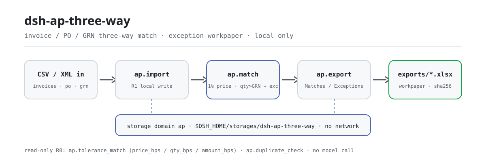
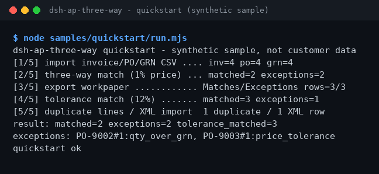

<div align="center">

<picture>
  <source media="(prefers-color-scheme: dark)" srcset="docs/assets/dsh-ap-three-way-flow-dark.svg">
  
</picture>

# dsh-ap-three-way

**Match invoices, purchase orders, and goods receipts line by line — postable rows pass, exceptions land in a workpaper with their reasons.**

A purely local AP three-way-match plugin for DeepSeek Harness: CSV/XML import, a 1% default price tolerance, a bps-tunable tolerance policy, and duplicate-line detection — no network, no model call.

[Install](#three-step-setup) · [Configuration](#configuration) · [FAQ](#faq) · [简体中文](README.md) · [English](README.en.md) · [Español](README.es.md) · [Português](README.pt.md) · [हिन्दी](README.hi.md)

[](LICENSE)
[](#compatibility)
[](https://www.npmjs.com/package/dsh-ap-three-way)
[](https://github.com/PerryLink/dsh-ap-three-way/actions/workflows/ci.yml)
[](#compatibility)

[](https://github.com/PerryLink/dsh-ap-three-way/stargazers)
[](https://www.npmjs.com/package/dsh-ap-three-way)
[](https://dshfind.com/plugins/PerryLink/dsh-ap-three-way?ref=badge)
[](https://dsh.market/)
[](https://gitee.com/perrylink/dsh-ap-three-way)

```sh
dsh plugin --profile <profile> add dsh-ap-three-way
```

</div>

<sub>Community plugin, not affiliated with DeepSeek. Canonical repository: <https://github.com/PerryLink/dsh-ap-three-way> (Gitee is a mirror). Status: alpha · verified on public/synthetic data only · not GA — no customer data or customer evidence, no production-readiness claim.</sub>

## What it is

Accounts-payable three-way matching: every invoice line is matched against its purchase order (PO) and goods receipt (GRN); the unit price passes within a 1% default tolerance, while quantity over receipt, a missing PO, or a missing receipt counts as an exception. Matches and exception reasons land in a local storage domain, and one command exports a two-sheet xlsx workpaper (Matches / Exceptions). Everything runs on your machine — no network, no model call, no upload; inputs are read by the session and passed to the tools as arguments, and the original files are never touched.

- **Good fit**: invoice/PO/GRN CSVs of tens to a few hundred lines; AP reconciliation that needs a "postable / exception" list under a tolerance policy plus a workpaper trail.
- **Not a fit**: automatic posting, vendor-master changes, or replacing approvals — this package only matches locally and never modifies any document.

## Three-step setup

1. **Install** (pick one channel):

   ```sh
   # npm channel (recommended; published releases)
   dsh plugin --profile <profile> add dsh-ap-three-way
   # git channel (latest main; equivalent to git+https://github.com/PerryLink/dsh-ap-three-way.git)
   dsh plugin --profile <profile> add github:PerryLink/dsh-ap-three-way
   # tarball channel: pnpm pack in this repo, then
   dsh plugin --profile <profile> add ./dsh-ap-three-way-<version>.tgz
   ```

2. **Minimal config** (the install command already applies the bundle patch; hand-written profiles paste this one row):

   ```yaml
   - insert:
       - id: dsh-ap-three-way
         name: dsh-ap-three-way
   ```

   The plugin has no plugin-level config keys; the tolerance policy is passed as tool arguments — see "Configuration".

3. **Verify it mounts**:

   ```sh
   dsh --profile <profile> --dump-config | grep dsh-ap-three-way
   ```

   A synthetic sample ships with the repo — run the full pipeline once (it should end with `quickstart ok`):

   ```sh
   node samples/quickstart/run.mjs
   ```

**Uninstall**: `dsh plugin --profile <profile> remove dsh-ap-three-way` (or remove the row from the profile patch).

Inside a session you can also just ask for it — this is the one-line demo prompt shipped in `package.json` as `dsh.demo.prompt`:

```text
帮我用自带样例做一次发票、采购单、收货单三单匹配，把能过的和例外分别列出来。
```

<details>
<summary>Install from the DSH Desktop market</summary>

Every PerryLink plugin is listed in the built-in DSH Desktop market: **Market → Sources → Add source → paste** `https://perrylink-dsh-catalog.perrylink.workers.dev/catalog-source.json` **→ select**. Installation still requires the market's npm identity check and your confirmation.

</details>

## Core capabilities

- **Three-way match** — `ap_match` matches every invoice line against its PO and GRN: a 1% default unit-price tolerance, and quantity over receipt is an exception; matched/exception plus the reason are written to the local storage domain.
- **Configurable tolerance re-run** — `ap_tolerance_match` sets price, quantity, and amount tolerances independently in basis points; read-only, never overwrites stored matches.
- **Duplicate invoice-line detection** — `ap_duplicate_check` flags duplicate lines before matching by supplier (case- and space-insensitive), PO line, quantity, and amount; read-only.
- **Exception workpaper export** — `ap_export` writes the Matches / Exceptions sheets to `exports/ap-<timestamp>.xlsx` and returns the path plus its sha256.
- **Invoice XML import** — `ap_import_invoice_xml` parses a local generic invoice XML (root `<Invoice>`, with `Seller/Name` and `Items/Item`).
- **Purely local** — no HTTP / DNS / WebSocket calls in the source; no ERP or vendor-system connections, nothing uploaded.

### Tool surface

Tool names are a stable API (a compatibility promise since 0.1.0 — breaking changes require a minor bump). Writing tools are marked **R1 (local write)**, read-only tools **R0**.

Since 0.2.0 tool names use underscores (e.g. `ap_import`): the provider validates `tools[].name` against `^[a-zA-Z0-9_-]+$`, and a dot makes it reject the whole `tools` array. The old dotted names are no longer registered — migrate using the table below.

| Tool | Purpose | Risk |
|---|---|---|
| `ap_import` | Import invoice, PO, and GRN rows (CSV text passed as arguments); re-importing the same invoice is skipped via `skipped` | R1 local write |
| `ap_import_invoice_xml` | Import invoice lines from a local generic invoice XML, optional PO reference | R1 local write |
| `ap_match` | Three-way match: 1% default unit-price tolerance, quantity over receipt is an exception; stores matches and exceptions | R1 local write |
| `ap_export` | Export the two-sheet Matches / Exceptions xlsx workpaper | R1 local write |
| `ap_tolerance_match` | Re-run the three-way match under a configurable tolerance (bps); read-only, never overwrites stored matches | R0 read-only |
| `ap_duplicate_check` | Detect duplicate invoice lines before matching | R0 read-only |

### Input and output

Input:

- Invoice CSV: UTF-8, header `supplier,invoice_no,po_no,line_no,qty,unit_price,amount` (`invoice_no` may be omitted).
- PO CSV: `po_no,line_no,qty,unit_price,amount`; GRN CSV: `po_no,line_no,qty`.
- Invoice XML: root `<Invoice>` with `Seller/Name` and `Items/Item` (`Quantity` / `UnitPrice` / `Amount`).
- Amounts carry at most two decimals; keep each file ≤5 MB. The shipped sample lives in `samples/quickstart/input/` (synthetic, far below 500 KB).

Output:

- Terminal summary: how many lines postable, how many exceptions, at the 1% default price tolerance.
- Workpaper: `$DSH_HOME/storages/dsh-ap-three-way/exports/ap-<timestamp>.xlsx` with `Matches` / `Exceptions` sheets, plus a sha256.
- Original files are never modified.

### Examples

Quickstart sample (synthetic, shipped with the package):

```sh
node samples/quickstart/run.mjs        # human-readable transcript, should end with quickstart ok
node samples/quickstart/run.mjs --json # canonical result — the source of the expected/result.json gold file
```



*Synthetic sample → gold file `samples/quickstart/expected/result.json`; the command and output hashes are recorded in `screenshots.json` (real run on 2026-11-02).*

Public-fixture acceptance: input [`fixtures/public/mit/invoice-github-sample.xml`](https://github.com/PerryLink/dsh-ap-three-way/blob/main/fixtures/public/mit/invoice-github-sample.xml) (public MIT sample); re-run `node scripts/acceptance.mjs`. Details in `ACCEPTANCE.csv`, quoted verbatim:

```text
req_id,metric,threshold,actual,pass,source,counted
SKU-05-A01,发票行解析,20/20,20,true,public/synthetic,false
PS1-QS01,quickstart 样例与金标一致,1/1,1,true,synthetic/quickstart,true
```

*The SKU row is a public/synthetic fixture check (`counted=false`); PS1-QS01 is a local reproduction of the shipped sample (`counted=true`). Neither is a customer run, and no output is invented.*

## Configuration

This plugin has no Schemastery `Config` keys — `cordis.patch.yml` only `insert`s one row (see "Three-step setup"), so there is no plugin-level key to override. The tolerance policy is passed as arguments to `ap_tolerance_match`:

| Parameter | Default | Meaning |
|---|---|---|
| `price_bps` | `100` | Unit-price tolerance in basis points (100 = 1%); integer 0–10000 |
| `qty_bps` | `0` | Quantity tolerance relative to the received quantity; default 0 — quantity over receipt is an exception |
| `amount_bps` | `0` | Amount tolerance; default 0 disables the amount dimension |
| `min_price_cents` | `1` | Floor for the unit-price tolerance (cents), so small-amount lines are not judged too strictly |

Out-of-range arguments (non-integer, negative, above 10000) fail loudly at call time in the uniform error format (one plain message + an `E_XXX` code + the next step), e.g.:

```text
容差参数 price_bps 超出范围（E_AP_POLICY）｜下一步：把 price_bps 设为 0–10000 的整数
```

`ap_match` always uses the default 1% unit-price tolerance plus "quantity not over receipt"; only `ap_tolerance_match` accepts these four parameters.

## FAQ

<details>
<summary>Where does the data live? Are my original files touched?</summary>

Match state (invoices, PO, GRN, match results) is written only to the local storage domain `$DSH_HOME/storages/dsh-ap-three-way`; exported workpapers go to its `exports/` subdirectory. Input CSV/XML is read by the session and passed to the tools as arguments — the original files are never modified, and nothing is uploaded.

</details>

<details>
<summary>Install fails — what now?</summary>

Confirm DSH `>=0.2.1-rc.3 <0.4.0` and Node `>=24.9 <25`, then retry with a fresh `DSH_HOME`; the full steps are in [TROUBLESHOOTING.md](TROUBLESHOOTING.md).

</details>

<details>
<summary>The price is within 1% — why is the line still an exception?</summary>

The default tolerance only relaxes the unit price; quantity over the GRN (`qty_over_grn`) is still an exception, as are a missing PO (`po_missing`) and a missing receipt (`grn_missing`). To relax further, call `ap_tolerance_match` with explicit `price_bps` / `qty_bps` / `amount_bps` and keep the policy parameters on record.

</details>

<details>
<summary>Can it process my real invoices?</summary>

It runs locally, but the package is alpha and verified only on public/synthetic data — it is not an audit or payment conclusion. Sanitize real data before use and keep a human reviewer in the loop.

</details>

<details>
<summary>Does it make network calls or upload data?</summary>

No. The tools, the sample, and the export all run on your machine; the source contains no HTTP / DNS / WebSocket calls.

</details>

## Security boundaries

- **No network, no model call.** Unless a tool explicitly says so, there is no model or network call; input and output stay local.
- **Original files are never modified.** Writes land only in `$DSH_HOME/storages/dsh-ap-three-way` (match state and `exports/*.xlsx`).
- **Path-traversal guard on export.** Export file names pass a safe-path guard; invoice ids are content hashes; PO/GRN headers are validated; re-importing the same invoice is idempotently skipped.
- **Uniform errors, loud failures.** Errors follow one format — a plain one-line message, an `E_XXX` code, and the next step; full errors and stack traces go to the log only and never print internal paths. The three most common cases — unreadable amount (`E_AP_CSV_INVALID`), missing CSV column (`E_AP_CSV_INVALID`), out-of-range tolerance (`E_AP_POLICY`) — are listed with symptom/cause/action in [TROUBLESHOOTING.md](TROUBLESHOOTING.md).

## Permissions & data

- **Reads**: the invoice / PO / GRN CSVs and invoice XML you point at (read by the session and passed in as arguments); no other directories.
- **Writes**: `$DSH_HOME/storages/dsh-ap-three-way` (match state and `exports/*.xlsx`); original files untouched.
- **Network**: no (no HTTP / DNS / WebSocket calls in the source).
- **External systems**: none (no ERP / vendor-system connections, no uploads).
- **Data boundary**: verified on public/synthetic samples only; no customer data, no customer evidence.

## Known limitations

- **Verified on public/synthetic data only.** Every acceptance row comes from a public or synthetic fixture (`counted=false` for the SKU rows in `ACCEPTANCE.csv`; PS1-QS01 is a local sample reproduction with `counted=true`); no customer data or customer evidence.
- **Alpha / partial / not counted / not GA.** No production-readiness claim; not an audit or payment conclusion.
- **Matching only, no posting.** It does not post automatically, change vendor master data, or replace approvals; it only matches locally and modifies no document.
- **Input format constraints.** Amounts carry at most two decimals; keep each file ≤5 MB; CSV headers must match verbatim (a missing column raises `E_AP_CSV_INVALID`).
- **Per-tool boundaries** are exactly the tool table above plus `ACCEPTANCE.csv`.

## Compatibility

| Surface | Status |
|---|---|
| Harness | DeepSeek Harness `>=0.2.1-rc.3 <0.4.0` (`engines.dsh` in `package.json`) |
| Node | `>=24.9.0 <25` (`.nvmrc`: 24) |
| Platforms | Anywhere DSH runs; local files only |
| Data | No network, no model call, no upload |

## Ecosystem & quality

- [Gitee mirror](https://gitee.com/perrylink/dsh-ap-three-way) (sync mirror; GitHub is canonical)
- [dshfind plugin page](https://dshfind.com/plugins/PerryLink/dsh-ap-three-way) (installs and ranking)
- [DSH Market](https://dsh.market/) (listed)
- **1024 store channel**: `npm i -g dsh1024` once, then `dsh1024 plugin --profile <profile> add dsh-ap-three-way` (counts toward the [deepseek1024.com](https://deepseek1024.com) install ranking)
- [Domain index](https://perrylink.github.io/dsh-plugins/) · [Checker family](https://perrylink.github.io/zh/checkers/) · [Scenario article](https://perrylink.github.io/dsh-plugins/articles/finops-suite.html)

### Related work and checkers

Sibling packages and family indexes: [dsh-einvoice](https://github.com/PerryLink/dsh-einvoice) · [dsh-bankrec](https://github.com/PerryLink/dsh-bankrec) · [dsh-travel-recon](https://github.com/PerryLink/dsh-travel-recon) · [dsh-finops-suite](https://github.com/PerryLink/dsh-finops-suite)

Each checker is a separate package with its own rule pack and version; install only the ones you need:

| Package | Why it is relevant |
|---|---|
| [`dsh-invoice-ledger`](https://github.com/PerryLink/dsh-invoice-ledger) | Invoice-side duplicate and arithmetic checks before or after the three-way match |
| [`dsh-excel-reconcile`](https://github.com/PerryLink/dsh-excel-reconcile) | Fallback two-table alignment when PO/GRN data arrives as flat files |

## Development

```sh
pnpm install --frozen-lockfile                            # node >=24.9 <25
pnpm build && pnpm lint && pnpm typecheck && pnpm test    # tsc build + lint + 27 node --test cases
pnpm gate:sku05                                           # acceptance gate (ACCEPTANCE.csv)
node scripts/acceptance.mjs                               # re-run the public/synthetic acceptance
node samples/quickstart/run.mjs                           # synthetic sample, should print quickstart ok
```

Current version `0.2.0` (matches `package.json`). Tests: `node --test test/*.test.mjs` all green (11 test files, 27 cases; `pnpm test` builds first). The README images are generated programmatically by [`scripts/gen-readme-assets.py`](scripts/gen-readme-assets.py) (Python; light/dark SVG flow pair shared by all five languages) and are safe to re-run: `python scripts/gen-readme-assets.py`.

Topics: `deepseek-harness`, `dsh`, `dsh-plugin`, `ap`, `three-way-match`, `finance`, `perrylink`, `invoice`

## Family & thanks

This project is part of the DeepSeek Harness plugin family from [PerryLink](https://github.com/PerryLink) (all Apache-2.0). If it is useful, **a star helps the next person find it** — nothing is gated behind it.

- [@PerryLink](https://github.com/PerryLink) — creator and maintainer: the three-way-match engine and tolerance policy, the six `ap.*` tools, the quickstart sample and acceptance suite, and the five-language docs.

## License

[LICENSE](LICENSE) (Apache License 2.0) © 2026 dsh-ap-three-way contributors; see also `NOTICE` and `THIRD-PARTY-NOTICES`.

<p align="center"><sub>Apache-2.0 · Community plugin, not affiliated with DeepSeek.</sub></p>
