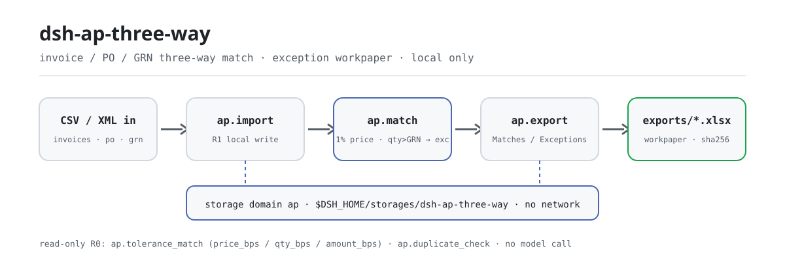
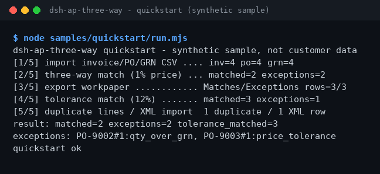

<div align="center">

<picture>
  <source media="(prefers-color-scheme: dark)" srcset="docs/assets/dsh-ap-three-way-flow-dark.svg">
  
</picture>

# dsh-ap-three-way

**Concilia facturas, órdenes de compra y recepciones línea a línea: las líneas contabilizables pasan y las excepciones quedan en una hoja de trabajo con sus motivos.**

Un plugin de conciliación triple de AP puramente local para DeepSeek Harness: importación CSV/XML, tolerancia de precio predeterminada del 1%, política de tolerancia ajustable en bps y detección de líneas duplicadas — sin red y sin llamadas a un modelo.

[Instalar](#instalación-en-tres-pasos) · [Configuración](#configuración) · [FAQ](#faq) · [简体中文](README.md) · [English](README.en.md) · [Español](README.es.md) · [Português](README.pt.md) · [हिन्दी](README.hi.md)

[](LICENSE)
[](#compatibilidad)
[](https://www.npmjs.com/package/dsh-ap-three-way)
[](https://github.com/PerryLink/dsh-ap-three-way/actions/workflows/ci.yml)
[](#compatibilidad)

[](https://github.com/PerryLink/dsh-ap-three-way/stargazers)
[](https://www.npmjs.com/package/dsh-ap-three-way)
[](https://dshfind.com/plugins/PerryLink/dsh-ap-three-way?ref=badge)
[](https://dsh.market/)
[](https://gitee.com/perrylink/dsh-ap-three-way)

```sh
dsh plugin --profile <profile> add dsh-ap-three-way
```

</div>

<sub>Plugin de la comunidad, no afiliado a DeepSeek. Repositorio canónico: <https://github.com/PerryLink/dsh-ap-three-way> (Gitee es un espejo). Estado: alpha · verificado solo con datos públicos/sintéticos · no GA — sin datos ni evidencia de clientes, sin promesa de producción.</sub>

## Qué es

Conciliación triple de cuentas por pagar: cada línea de factura se confronta con su orden de compra (OC) y su recepción (GRN); el precio unitario pasa dentro de una tolerancia predeterminada del 1%, mientras que cantidad por encima de lo recibido, OC ausente o recepción ausente cuentan como excepción. Los resultados y los motivos de excepción quedan en un dominio de almacenamiento local, y un comando exporta una hoja de trabajo xlsx de dos pestañas (Matches / Exceptions). Todo se ejecuta en tu máquina — sin red, sin llamadas a un modelo, sin subidas; las entradas las lee la sesión y se pasan a las herramientas como argumentos, y los archivos originales no se tocan.

- **Adecuado para**: CSV de facturas/OC/recepciones de decenas a unos pocos cientos de líneas; conciliaciones de AP que necesitan una lista «contabilizable / excepción» bajo una política de tolerancia con hoja de trabajo.
- **No adecuado para**: contabilización automática, cambios en el maestro de proveedores o sustituir aprobaciones; este paquete solo concilia en local y no modifica ningún documento.

## Instalación en tres pasos

1. **Instalar** (elige un canal):

   ```sh
   # canal npm (recomendado; versiones publicadas)
   dsh plugin --profile <profile> add dsh-ap-three-way
   # canal git (último main; equivalente a git+https://github.com/PerryLink/dsh-ap-three-way.git)
   dsh plugin --profile <profile> add github:PerryLink/dsh-ap-three-way
   # canal tarball: pnpm pack en este repo, luego
   dsh plugin --profile <profile> add ./dsh-ap-three-way-<version>.tgz
   ```

2. **Configuración mínima** (el comando de instalación ya aplica el bundle patch; los perfiles escritos a mano pegan esta única fila):

   ```yaml
   - insert:
       - id: dsh-ap-three-way
         name: dsh-ap-three-way
   ```

   El plugin no tiene claves de configuración propias; la política de tolerancia se pasa como argumentos de la herramienta — ver «Configuración».

3. **Verificar que se monta**:

   ```sh
   dsh --profile <profile> --dump-config | grep dsh-ap-three-way
   ```

   El repo incluye una muestra sintética: ejecuta la cadena completa una vez (debe terminar con `quickstart ok`):

   ```sh
   node samples/quickstart/run.mjs
   ```

   Dentro de una sesión también basta con pedirlo (prompt citado de `dsh.demo` en `package.json`):

   ```text
   帮我用自带样例做一次发票、采购单、收货单三单匹配，把能过的和例外分别列出来。
   ```

**Desinstalar**: `dsh plugin --profile <profile> remove dsh-ap-three-way` (o quita la fila del patch del perfil).

<details>
<summary>Instalar desde el mercado de DSH Desktop</summary>

Todos los plugins de PerryLink están en el mercado integrado de DSH Desktop: **Market → Sources → Add source → pega** `https://perrylink-dsh-catalog.perrylink.workers.dev/catalog-source.json` **→ selecciona**. La instalación sigue requiriendo la verificación de identidad npm del mercado y tu confirmación.

</details>

## Capacidades clave

- **Conciliación triple** — `ap_match` confronta cada línea de factura con su OC y su GRN: tolerancia de precio unitario predeterminada del 1%, y cantidad por encima de lo recibido es excepción; matched/exception y el motivo se escriben en el dominio de almacenamiento local.
- **Recálculo con tolerancia configurable** — `ap_tolerance_match` fija tolerancias de precio, cantidad e importe de forma independiente en puntos básicos; solo lectura, nunca sobrescribe las conciliaciones guardadas.
- **Detección de líneas de factura duplicadas** — `ap_duplicate_check` marca duplicados antes de conciliar por proveedor (sin distinguir mayúsculas ni espacios), línea de OC, cantidad e importe; solo lectura.
- **Exportación de la hoja de excepciones** — `ap_export` escribe las pestañas Matches / Exceptions en `exports/ap-<timestamp>.xlsx` y devuelve la ruta con su sha256.
- **Importación de XML de factura** — `ap_import_invoice_xml` analiza un XML de factura genérico local (raíz `<Invoice>`, con `Seller/Name` y `Items/Item`).
- **Puramente local** — sin llamadas HTTP / DNS / WebSocket en el código; sin conexiones a ERP ni a sistemas de proveedores, nada se sube.

### Superficie de herramientas

Los nombres de las herramientas son una API estable (promesa de compatibilidad desde 0.1.0: los cambios disruptivos requieren un bump minor). Las herramientas que escriben se marcan **R1 (escritura local)** y las de solo lectura **R0**.

Desde 0.2.0 los nombres usan guiones bajos (p. ej. `ap_import`): el proveedor valida `tools[].name` con `^[a-zA-Z0-9_-]+$` y un punto hace que se rechace todo el array `tools`. Los nombres con punto ya no se registran; migra según la tabla siguiente.

| Herramienta | Propósito | Riesgo |
|---|---|---|
| `ap_import` | Importar filas de factura, OC y GRN (texto CSV como argumentos); reimportar la misma factura se omite vía `skipped` | R1 escritura local |
| `ap_import_invoice_xml` | Importar líneas de factura desde un XML genérico local, con referencia de OC opcional | R1 escritura local |
| `ap_match` | Conciliación triple: tolerancia de precio unitario predeterminada del 1%, cantidad por encima de lo recibido es excepción; guarda conciliaciones y excepciones | R1 escritura local |
| `ap_export` | Exportar la hoja xlsx de dos pestañas Matches / Exceptions | R1 escritura local |
| `ap_tolerance_match` | Repetir la conciliación triple con tolerancia configurable (bps); solo lectura, no sobrescribe lo guardado | R0 solo lectura |
| `ap_duplicate_check` | Detectar líneas de factura duplicadas antes de conciliar | R0 solo lectura |

### Entrada y salida

Entrada:

- CSV de facturas: UTF-8, cabecera `supplier,invoice_no,po_no,line_no,qty,unit_price,amount` (`invoice_no` puede omitirse).
- CSV de OC: `po_no,line_no,qty,unit_price,amount`; CSV de GRN: `po_no,line_no,qty`.
- XML de factura: raíz `<Invoice>` con `Seller/Name` y `Items/Item` (`Quantity` / `UnitPrice` / `Amount`).
- Los importes llevan como máximo dos decimales; cada archivo ≤5 MB recomendado. La muestra incluida está en `samples/quickstart/input/` (sintética, muy por debajo de 500 KB).

Salida:

- Resumen en terminal: cuántas líneas contabilizables y cuántas excepciones, con la tolerancia de precio predeterminada del 1%.
- Hoja de trabajo: `$DSH_HOME/storages/dsh-ap-three-way/exports/ap-<timestamp>.xlsx` con las pestañas `Matches` / `Exceptions`, más un sha256.
- Los archivos originales nunca se modifican.

### Ejemplos

Muestra de inicio rápido (sintética, incluida en el paquete):

```sh
node samples/quickstart/run.mjs        # transcripción legible, debe terminar con quickstart ok
node samples/quickstart/run.mjs --json # resultado canónico — origen del oro expected/result.json
```



*Muestra sintética → archivo de oro `samples/quickstart/expected/result.json`; el comando y los hashes de salida están en `screenshots.json` (ejecución real del 2026-11-02).*

Aceptación con fixture pública: entrada [`fixtures/public/mit/invoice-github-sample.xml`](https://github.com/PerryLink/dsh-ap-three-way/blob/main/fixtures/public/mit/invoice-github-sample.xml) (muestra MIT pública); se repite con `node scripts/acceptance.mjs`. Detalle en `ACCEPTANCE.csv`, citado literalmente:

```text
req_id,metric,threshold,actual,pass,source,counted
SKU-05-A01,发票行解析,20/20,20,true,public/synthetic,false
PS1-QS01,quickstart 样例与金标一致,1/1,1,true,synthetic/quickstart,true
```

*La fila SKU es una comprobación de fixture pública/sintética (`counted=false`); PS1-QS01 es una reproducción local de la muestra incluida (`counted=true`). Ninguna es una ejecución de cliente y no se inventa salida.*

## Configuración

Este plugin no tiene claves `Config` de Schemastery — `cordis.patch.yml` solo `insert` una fila (ver «Instalación en tres pasos»), así que no hay ninguna clave de plugin que sobrescribir. La política de tolerancia se pasa como argumentos a `ap_tolerance_match`:

| Parámetro | Predeterminado | Significado |
|---|---|---|
| `price_bps` | `100` | Tolerancia de precio unitario en puntos básicos (100 = 1%); entero 0–10000 |
| `qty_bps` | `0` | Tolerancia de cantidad relativa a lo recibido; por defecto 0 — cantidad por encima de lo recibido es excepción |
| `amount_bps` | `0` | Tolerancia de importe; por defecto 0, la dimensión de importe está desactivada |
| `min_price_cents` | `1` | Suelo de la tolerancia de precio unitario (céntimos), para que las líneas de importe pequeño no se juzguen con demasiada severidad |

Los argumentos fuera de rango (no enteros, negativos, mayores que 10000) fallan en voz alta al llamar, con el formato de error `<qué pasó>（E_XXX）｜下一步：<acción>`, por ejemplo:

```text
容差参数 price_bps 超出范围（E_AP_POLICY）｜下一步：把 price_bps 设为 0–10000 的整数
```

`ap_match` usa siempre la tolerancia de precio unitario predeterminada del 1% más «cantidad no superior a lo recibido»; solo `ap_tolerance_match` acepta estos cuatro parámetros.

## FAQ

<details>
<summary>¿Dónde viven los datos? ¿Se tocan mis archivos originales?</summary>

El estado de conciliación (facturas, OC, GRN, resultados) solo se escribe en el dominio de almacenamiento local `$DSH_HOME/storages/dsh-ap-three-way`; las hojas exportadas van a su subdirectorio `exports/`. Las entradas CSV / XML las lee la sesión y se pasan a las herramientas como argumentos — los archivos originales nunca se modifican y no se sube nada.

</details>

<details>
<summary>¿Qué hago si no se instala?</summary>

Confirma DSH `>=0.2.1-rc.3 <0.4.0` y Node `>=24.9 <25`, y reintenta con un `DSH_HOME` nuevo; los pasos completos están en [TROUBLESHOOTING.md](TROUBLESHOOTING.md).

</details>

<details>
<summary>El precio está dentro del 1%, ¿por qué la línea sigue siendo excepción?</summary>

La tolerancia predeterminada solo relaja el «precio unitario»; la cantidad por encima de la recepción (`qty_over_grn`) sigue siendo excepción, igual que una OC ausente (`po_missing`) o una recepción ausente (`grn_missing`). Para relajar más, llama a `ap_tolerance_match` con `price_bps` / `qty_bps` / `amount_bps` explícitos y conserva los parámetros de la política.

</details>

<details>
<summary>¿Puede procesar mis facturas reales?</summary>

Se ejecuta en local, pero el paquete es alpha y solo está verificado con datos públicos/sintéticos — no constituye una conclusión de auditoría ni de pago. Anonimiza los datos reales antes de usarlos y mantén un revisor humano.

</details>

<details>
<summary>¿Hace llamadas de red o sube datos?</summary>

No. Las herramientas, la muestra y la exportación se ejecutan en tu máquina; el código no contiene llamadas HTTP / DNS / WebSocket.

</details>

## Límites de seguridad

- **Sin red, sin llamadas a un modelo.** Salvo que una herramienta lo indique, no hay llamadas a modelo ni de red; la entrada y la salida permanecen locales.
- **Los archivos originales nunca se modifican.** Las escrituras solo caen en `$DSH_HOME/storages/dsh-ap-three-way` (estado de conciliación y `exports/*.xlsx`).
- **Guardia contra path traversal en la exportación.** Los nombres de archivo exportados pasan una guardia safe-path; los id de factura son hashes de contenido; las cabeceras de OC/GRN se validan; reimportar la misma factura se omite de forma idempotente.
- **Errores uniformes, fallos en voz alta.** Los errores siguen el formato `<qué pasó>（E_XXX）｜下一步：<acción>`; el error completo y la pila solo se escriben en el log y nunca imprimen rutas internas. Los tres casos más comunes — importe ilegible (`E_AP_CSV_INVALID`), columna CSV ausente (`E_AP_CSV_INVALID`), tolerancia fuera de rango (`E_AP_POLICY`) — aparecen con síntoma/causa/acción en [TROUBLESHOOTING.md](TROUBLESHOOTING.md).

## Permisos y datos

- **Lee**: los CSV de factura / OC / GRN y el XML de factura que tú indiques (leídos por la sesión y pasados como argumentos); ningún otro directorio.
- **Escribe**: `$DSH_HOME/storages/dsh-ap-three-way` (estado de conciliación y `exports/*.xlsx`); los originales intactos.
- **Red**: no (sin llamadas HTTP / DNS / WebSocket en el código).
- **Sistemas externos**: ninguno (sin conexiones a ERP ni a sistemas de proveedores, sin subidas).
- **Frontera de datos**: verificado solo con muestras públicas/sintéticas; sin datos ni evidencia de clientes.

## Limitaciones conocidas

- **Verificado solo con datos públicos/sintéticos.** Cada fila de aceptación proviene de una fixture pública o sintética (filas SKU con `counted=false` en `ACCEPTANCE.csv`; PS1-QS01 es una reproducción local de la muestra con `counted=true`); sin datos ni evidencia de clientes.
- **Alpha / parcial / no contabilizado / no GA.** Sin promesa de producción; no constituye conclusión de auditoría ni de pago.
- **Solo concilia, no contabiliza.** No contabiliza automáticamente, no cambia el maestro de proveedores ni sustituye aprobaciones; solo concilia en local y no modifica ningún documento.
- **Restricciones de formato de entrada.** Importes con dos decimales como máximo; cada archivo ≤5 MB recomendado; las cabeceras CSV deben coincidir literalmente (una columna ausente eleva `E_AP_CSV_INVALID`).
- **Los límites exactos por herramienta** son la tabla de herramientas de arriba más `ACCEPTANCE.csv`.

## Compatibilidad

| Superficie | Estado |
|---|---|
| Harness | DeepSeek Harness `>=0.2.1-rc.3 <0.4.0` (`engines.dsh` en `package.json`) |
| Node | `>=24.9.0 <25` (`.nvmrc`: 24) |
| Plataformas | Dondequiera que DSH se ejecute; solo archivos locales |
| Datos | Sin red, sin llamadas a un modelo, sin subidas |

## Ecosistema y calidad

- [Espejo en Gitee](https://gitee.com/perrylink/dsh-ap-three-way) (espejo sincronizado; GitHub es el canónico)
- [Página del plugin en dshfind](https://dshfind.com/plugins/PerryLink/dsh-ap-three-way) (instalaciones y ranking)
- [DSH Market](https://dsh.market/) (listado)
- **Canal de la tienda 1024**: `npm i -g dsh1024` una vez, luego `dsh1024 plugin --profile <profile> add dsh-ap-three-way` (cuenta en el ranking de instalaciones de [deepseek1024.com](https://deepseek1024.com))
- [Índice de dominio](https://perrylink.github.io/dsh-plugins/) · [Familia de checkers](https://perrylink.github.io/zh/checkers/) · [Artículo de escenario](https://perrylink.github.io/dsh-plugins/articles/finops-suite.html)

### Trabajo relacionado y checkers

Paquetes hermanos e índices de la familia: [dsh-einvoice](https://github.com/PerryLink/dsh-einvoice) · [dsh-bankrec](https://github.com/PerryLink/dsh-bankrec) · [dsh-travel-recon](https://github.com/PerryLink/dsh-travel-recon) · [dsh-finops-suite](https://github.com/PerryLink/dsh-finops-suite)

Cada checker es un paquete independiente con su propio paquete de reglas y versión; instala solo los que necesites:

| Paquete | Por qué es relevante |
|---|---|
| [`dsh-invoice-ledger`](https://github.com/PerryLink/dsh-invoice-ledger) | Comprobaciones de duplicados y aritmética del lado de la factura antes o después de la conciliación triple |
| [`dsh-excel-reconcile`](https://github.com/PerryLink/dsh-excel-reconcile) | Alineación de dos tablas como fallback cuando los datos de OC/GRN llegan como archivos planos |

## Desarrollo

```sh
pnpm install --frozen-lockfile                            # node >=24.9 <25
pnpm build && pnpm lint && pnpm typecheck && pnpm test    # build tsc + lint + 27 casos node --test
pnpm gate:sku05                                           # puerta de aceptación (ACCEPTANCE.csv)
node scripts/acceptance.mjs                               # repetir la aceptación pública/sintética
node samples/quickstart/run.mjs                           # muestra sintética, debe imprimir quickstart ok
```

Versión actual `0.2.0` (coincide con `package.json`). Pruebas: `node --test test/*.test.mjs` todo en verde (11 archivos de prueba, 27 casos; `pnpm test` compila primero). Las imágenes del README se generan programáticamente con [`scripts/gen-readme-assets.py`](scripts/gen-readme-assets.py) (Python; par SVG de flujo claro/oscuro compartido por los cinco idiomas) y se pueden repetir: `python scripts/gen-readme-assets.py`.

Topics: `deepseek-harness`, `dsh`, `dsh-plugin`, `ap`, `three-way-match`, `finance`, `perrylink`, `invoice`

## Familia y agradecimientos

Este proyecto forma parte de la familia de plugins de DeepSeek Harness de [PerryLink](https://github.com/PerryLink) (todos Apache-2.0). Si te resulta útil, **una estrella ayuda a que la siguiente persona lo encuentre** — no hay nada bloqueado tras ella.

- [@PerryLink](https://github.com/PerryLink) — creador y mantenedor: el motor de conciliación triple y la política de tolerancia, las seis herramientas `ap.*`, la muestra quickstart y la suite de aceptación, y la documentación en cinco idiomas.

## Licencia

[LICENSE](LICENSE) (Apache License 2.0) © 2026 dsh-ap-three-way contributors; ver también `NOTICE` y `THIRD-PARTY-NOTICES`.

<p align="center"><sub>Apache-2.0 · Plugin de la comunidad, no afiliado a DeepSeek.</sub></p>
