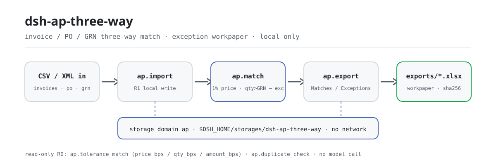
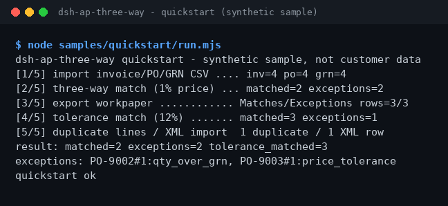

<div align="center">

<picture>
  <source media="(prefers-color-scheme: dark)" srcset="docs/assets/dsh-ap-three-way-flow-dark.svg">
  
</picture>

# dsh-ap-three-way

**इनवॉइस, परचेज़ ऑर्डर और गुड्स रसीद को पंक्ति-दर-पंक्ति मिलाएँ — पोस्ट होने योग्य पंक्तियाँ पास होती हैं, अपवाद अपने कारणों के साथ वर्कपेपर में उतरते हैं।**

DeepSeek Harness के लिए पूरी तरह स्थानीय AP तीन-तरफ़ा मिलान प्लगइन: CSV/XML इम्पोर्ट, 1% डिफ़ॉल्ट मूल्य टॉलरेंस, bps में समायोज्य टॉलरेंस नीति और डुप्लिकेट पंक्ति पहचान — बिना नेटवर्क, बिना मॉडल कॉल।

[इंस्टॉल](#तीन-चरणों-में-शुरुआत) · [कॉन्फ़िगरेशन](#कॉन्फ़िगरेशन) · [FAQ](#faq) · [简体中文](README.md) · [English](README.en.md) · [Español](README.es.md) · [Português](README.pt.md) · [हिन्दी](README.hi.md)

[](LICENSE)
[](#संगतता)
[](https://www.npmjs.com/package/dsh-ap-three-way)
[](https://github.com/PerryLink/dsh-ap-three-way/actions/workflows/ci.yml)
[](#संगतता)

[](https://github.com/PerryLink/dsh-ap-three-way/stargazers)
[](https://www.npmjs.com/package/dsh-ap-three-way)
[](https://dshfind.com/plugins/PerryLink/dsh-ap-three-way?ref=badge)
[](https://dsh.market/)
[](https://gitee.com/perrylink/dsh-ap-three-way)

```sh
dsh plugin --profile <profile> add dsh-ap-three-way
```

</div>

<sub>सामुदायिक प्लगइन, DeepSeek से असंबद्ध। कैनोनिकल रिपॉज़िटरी: <https://github.com/PerryLink/dsh-ap-three-way> (Gitee एक मिरर है)। स्थिति: alpha · केवल सार्वजनिक/सिंथेटिक डेटा से सत्यापित · GA नहीं — कोई ग्राहक डेटा या ग्राहक साक्ष्य नहीं, उत्पादन-तैयारी का दावा नहीं।</sub>

## यह क्या है

अकाउंट्स-पेएबल तीन-तरफ़ा मिलान: हर इनवॉइस पंक्ति का मिलान उसके परचेज़ ऑर्डर (PO) और गुड्स रसीद (GRN) से होता है; यूनिट मूल्य 1% डिफ़ॉल्ट टॉलरेंस के भीतर पास होता है, जबकि रसीद से अधिक मात्रा, PO गायब या रसीद गायब अपवाद गिनी जाती है। मिलान परिणाम और अपवाद कारण स्थानीय स्टोरेज डोमेन में उतरते हैं, और एक कमांड दो-शीट xlsx वर्कपेपर (Matches / Exceptions) निर्यात करती है। सब कुछ आपकी मशीन पर चलता है — न नेटवर्क, न मॉडल कॉल, न अपलोड; इनपुट सत्र द्वारा पढ़कर टूलों को तर्क के रूप में दिए जाते हैं, और मूल फ़ाइलें नहीं छूई जातीं।

- **किसके लिए उपयुक्त**: कुछ दर्जन से कुछ सौ पंक्तियों वाले इनवॉइस/PO/GRN CSV; ऐसा AP रीकंसिलिएशन जिसे टॉलरेंस नीति के तहत «पोस्ट योग्य / अपवाद» सूची और वर्कपेपर रिकॉर्ड चाहिए।
- **किसके लिए नहीं**: ऑटो-पोस्टिंग, वेंडर मास्टर बदलाव या अप्रूवल की जगह लेना; यह पैकेज केवल स्थानीय मिलान करता है और कोई दस्तावेज़ नहीं बदलता।

## तीन चरणों में शुरुआत

1. **इंस्टॉल करें** (एक चैनल चुनें):

   ```sh
   # npm चैनल (अनुशंसित; प्रकाशित वर्ज़न)
   dsh plugin --profile <profile> add dsh-ap-three-way
   # git चैनल (नवीनतम main; git+https://github.com/PerryLink/dsh-ap-three-way.git के समतुल्य)
   dsh plugin --profile <profile> add github:PerryLink/dsh-ap-three-way
   # tarball चैनल: इस रेपो में pnpm pack करके
   dsh plugin --profile <profile> add ./dsh-ap-three-way-<version>.tgz
   ```

2. **न्यूनतम कॉन्फ़िगरेशन** (इंस्टॉल कमांड bundle patch पहले ही लागू कर देती है; हाथ से लिखे प्रोफ़ाइल यह एक पंक्ति चिपकाएँ):

   ```yaml
   - insert:
       - id: dsh-ap-three-way
         name: dsh-ap-three-way
   ```

   इस प्लगइन में कोई प्लगइन-स्तरीय कॉन्फ़िगरेशन कुंजी नहीं है; टॉलरेंस नीति टूल तर्कों के रूप में दी जाती है — «कॉन्फ़िगरेशन» देखें।

3. **माउंट होने की पुष्टि करें**:

   ```sh
   dsh --profile <profile> --dump-config | grep dsh-ap-three-way
   ```

   रेपो में सिंथेटिक सैंपल शामिल है — पूरी चेन एक बार चलाएँ (अंत में `quickstart ok` आना चाहिए):

   ```sh
   node samples/quickstart/run.mjs
   ```

   सत्र के अंदर सीधे कहना भी काफी है (प्रॉम्प्ट `package.json` के `dsh.demo` से उदृत):

   ```text
   帮我用自带样例做一次发票、采购单、收货单三单匹配，把能过的和例外分别列出来。
   ```

**अनइंस्टॉल**: `dsh plugin --profile <profile> remove dsh-ap-three-way` (या प्रोफ़ाइल पैच से वह पंक्ति हटाएँ)।

<details>
<summary>DSH Desktop मार्केट से इंस्टॉल करें</summary>

सभी PerryLink प्लगइन DSH Desktop के अंतर्निहित मार्केट में ब्राउज़ किए जा सकते हैं: **Market → Sources → Add source → पेस्ट करें** `https://perrylink-dsh-catalog.perrylink.workers.dev/catalog-source.json` **→ चुनें**। इंस्टॉलेशन के लिए मार्केट की npm पहचान जाँच और आपकी पुष्टि आवश्यक रहती है।

</details>

## मुख्य क्षमताएँ

- **तीन-तरफ़ा मिलान** — `ap_match` हर इनवॉइस पंक्ति का मिलान उसके PO और GRN से करता है: यूनिट मूल्य पर 1% डिफ़ॉल्ट टॉलरेंस, और रसीद से अधिक मात्रा अपवाद; matched/exception और कारण स्थानीय स्टोरेज डोमेन में लिखे जाते हैं।
- **कॉन्फ़िगरेबल टॉलरेंस पुनर्गणना** — `ap_tolerance_match` मूल्य, मात्रा और राशि टॉलरेंस को बेसिस पॉइंट में स्वतंत्र रूप से सेट करता है; रीड-ओनली, सहेजे मिलान को कभी अधिलेखित नहीं करता।
- **डुप्लिकेट इनवॉइस पंक्ति पहचान** — `ap_duplicate_check` मिलान से पहले सप्लायर (बड़े-छोटे अक्षर और स्पेस की परवाह किए बिना), PO पंक्ति, मात्रा और राशि से डुप्लिकेट पंक्तियाँ चिह्नित करता है; रीड-ओनली।
- **अपवाद वर्कपेपर निर्यात** — `ap_export` Matches / Exceptions शीटों को `exports/ap-<timestamp>.xlsx` में लिखता है और पथ के साथ sha256 लौटाता है।
- **इनवॉइस XML इम्पोर्ट** — `ap_import_invoice_xml` स्थानीय सामान्य इनवॉइस XML पार्स करता है (रूट `<Invoice>`, जिसमें `Seller/Name` और `Items/Item`)।
- **पूरी तरह स्थानीय** — स्रोत में कोई HTTP / DNS / WebSocket कॉल नहीं; न ERP न वेंडर सिस्टम से कनेक्शन, कुछ भी अपलोड नहीं।

### टूल सतह

टूल नाम स्थिर API हैं (0.1.0 से संगतता वचन: ब्रेकिंग बदलाव के लिए minor बम्प आवश्यक)। लिखने वाले टूल **R1 (स्थानीय लेखन)**, रीड-ओनली टूल **R0** चिह्नित हैं।

0.2.0 से टूल नामों में अंडरस्कोर है (जैसे `ap_import`): प्रोवाइडर `tools[].name` को `^[a-zA-Z0-9_-]+$` से जाँचता है, और बिंदु होने पर पूरा `tools` ऐरे अस्वीकार हो जाता है। पुराने बिंदु-युक्त नाम अब पंजीकृत नहीं होते; नीचे की तालिका के अनुसार माइग्रेट करें।

| टूल | उद्देश्य | जोखिम |
|---|---|---|
| `ap_import` | इनवॉइस, PO और GRN पंक्तियाँ आयात करें (CSV टेक्स्ट तर्क के रूप में); वही इनवॉइस दोबारा आयात करने पर `skipped` से छोड़ दिया जाता है | R1 स्थानीय लेखन |
| `ap_import_invoice_xml` | स्थानीय सामान्य इनवॉइस XML से इनवॉइस पंक्तियाँ आयात करें, वैकल्पिक PO संदर्भ | R1 स्थानीय लेखन |
| `ap_match` | तीन-तरफ़ा मिलान: 1% डिफ़ॉल्ट यूनिट-मूल्य टॉलरेंस, रसीद से अधिक मात्रा अपवाद; मिलान और अपवाद सहेजता है | R1 स्थानीय लेखन |
| `ap_export` | दो-शीट Matches / Exceptions xlsx वर्कपेपर निर्यात करें | R1 स्थानीय लेखन |
| `ap_tolerance_match` | कॉन्फ़िगरेबल टॉलरेंस (bps) के साथ तीन-तरफ़ा मिलान दोबारा चलाएँ; रीड-ओनली, सहेजे गए को अधिलेखित नहीं करता | R0 रीड-ओनली |
| `ap_duplicate_check` | मिलान से पहले डुप्लिकेट इनवॉइस पंक्तियाँ पहचानें | R0 रीड-ओनली |

### इनपुट और आउटपुट

इनपुट:

- इनवॉइस CSV: UTF-8, हेडर `supplier,invoice_no,po_no,line_no,qty,unit_price,amount` (`invoice_no` छोड़ा जा सकता है)।
- PO CSV: `po_no,line_no,qty,unit_price,amount`; GRN CSV: `po_no,line_no,qty`।
- इनवॉइस XML: रूट `<Invoice>`, जिसमें `Seller/Name` और `Items/Item` (`Quantity` / `UnitPrice` / `Amount`)।
- राशियों में अधिकतम दो दशमलव स्थान; प्रत्येक फ़ाइल ≤5 MB अनुशंसित। शामिल सैंपल `samples/quickstart/input/` में है (सिंथेटिक, 500 KB से काफी छोटा)।

आउटपुट:

- टर्मिनल सारांश: कितनी पंक्तियाँ पोस्ट योग्य, कितनी अपवाद, 1% डिफ़ॉल्ट मूल्य टॉलरेंस पर।
- वर्कपेपर: `$DSH_HOME/storages/dsh-ap-three-way/exports/ap-<timestamp>.xlsx`, जिसमें `Matches` / `Exceptions` शीट, साथ में sha256।
- मूल फ़ाइलें कभी संशोधित नहीं होतीं।

### उदाहरण

क्विकस्टार्ट सैंपल (सिंथेटिक, पैकेज के साथ):

```sh
node samples/quickstart/run.mjs        # मानव-पठनीय ट्रांसक्रिप्ट, quickstart ok पर समाप्त होना चाहिए
node samples/quickstart/run.mjs --json # कैनोनिकल परिणाम — expected/result.json गोल्ड फ़ाइल का स्रोत
```



*सिंथेटिक सैंपल → गोल्ड फ़ाइल `samples/quickstart/expected/result.json`; कमांड और आउटपुट हैश `screenshots.json` में दर्ज हैं (2026-11-02 का वास्तविक रन)।*

सार्वजनिक fixture स्वीकृति: इनपुट [`fixtures/public/mit/invoice-github-sample.xml`](https://github.com/PerryLink/dsh-ap-three-way/blob/main/fixtures/public/mit/invoice-github-sample.xml) (सार्वजनिक MIT सैंपल); `node scripts/acceptance.mjs` से दोबारा चलाएँ। विवरण `ACCEPTANCE.csv` में, यथामूल्य उदृत:

```text
req_id,metric,threshold,actual,pass,source,counted
SKU-05-A01,发票行解析,20/20,20,true,public/synthetic,false
PS1-QS01,quickstart 样例与金标一致,1/1,1,true,synthetic/quickstart,true
```

*SKU पंक्ति सार्वजनिक/सिंथेटिक fixture जाँच है (`counted=false`); PS1-QS01 शामिल सैंपल की स्थानीय पुनरुत्पत्ति है (`counted=true`)। दोनों में से कोई ग्राहक रन नहीं है और कोई आउटपुट नहीं गढ़ा गया।*

## कॉन्फ़िगरेशन

इस प्लगइन में कोई Schemastery `Config` कुंजी नहीं है — `cordis.patch.yml` केवल एक पंक्ति `insert` करता है («तीन चरणों में शुरुआत» देखें), इसलिए ओवरराइड करने लायक कोई प्लगइन-स्तरीय कुंजी नहीं। टॉलरेंस नीति `ap_tolerance_match` को तर्कों के रूप में दी जाती है:

| पैरामीटर | डिफ़ॉल्ट | अर्थ |
|---|---|---|
| `price_bps` | `100` | यूनिट-मूल्य टॉलरेंस बेसिस पॉइंट में (100 = 1%); पूर्णांक 0–10000 |
| `qty_bps` | `0` | प्राप्त मात्रा के सापेक्ष मात्रा टॉलरेंस; डिफ़ॉल्ट 0 — रसीद से अधिक मात्रा अपवाद |
| `amount_bps` | `0` | राशि टॉलरेंस; डिफ़ॉल्ट 0, राशि आयाम बंद |
| `min_price_cents` | `1` | यूनिट-मूल्य टॉलरेंस की न्यूनतम सीमा (सेंट), ताकि छोटी राशि वाली पंक्तियाँ अत्यधिक सख़्ती से न आँकी जाएँ |

सीमा से बाहर तर्क (गैर-पूर्णांक, ऋणात्मक, 10000 से अधिक) कॉल पर ठोस रूप से विफल होते हैं, त्रुटि प्रारूप `<क्या हुआ>（E_XXX）｜下一步：<कार्रवाई>` में, उदाहरण:

```text
容差参数 price_bps 超出范围（E_AP_POLICY）｜下一步：把 price_bps 设为 0–10000 的整数
```

`ap_match` हमेशा 1% डिफ़ॉल्ट यूनिट-मूल्य टॉलरेंस और «मात्रा रसीद से अधिक नहीं» का उपयोग करता है; केवल `ap_tolerance_match` ये चार पैरामीटर स्वीकार करता है।

## FAQ

<details>
<summary>डेटा वास्तव में कहाँ रहता है? क्या मेरी मूल फ़ाइलें छूई जाती हैं?</summary>

मिलान स्थिति (इनवॉइस, PO, GRN, मिलान परिणाम) केवल स्थानीय स्टोरेज डोमेन `$DSH_HOME/storages/dsh-ap-three-way` में लिखी जाती है; निर्यातित वर्कपेपर उसके `exports/` उपनिर्देशिका में जाते हैं। इनपुट CSV / XML सत्र द्वारा पढ़कर टूलों को तर्क के रूप में दिए जाते हैं — मूल फ़ाइलें कभी संशोधित नहीं होतीं और कुछ भी अपलोड नहीं होता।

</details>

<details>
<summary>इंस्टॉल न हो तो क्या करें?</summary>

DSH `>=0.2.1-rc.3 <0.4.0` और Node `>=24.9 <25` की पुष्टि करें, फिर नए `DSH_HOME` से पुनः प्रयास करें; पूरे चरण [TROUBLESHOOTING.md](TROUBLESHOOTING.md) में हैं।

</details>

<details>
<summary>मूल्य 1% के भीतर है — फिर पंक्ति अपवाद क्यों?</summary>

डिफ़ॉल्ट टॉलरेंस केवल «यूनिट मूल्य» ढीला करता है; रसीद से अधिक मात्रा (`qty_over_grn`) फिर भी अपवाद है, वैसे ही जैसे PO गायब (`po_missing`) और रसीद गायब (`grn_missing`)। और ढीला करने के लिए `ap_tolerance_match` को स्पष्ट `price_bps` / `qty_bps` / `amount_bps` के साथ कॉल करें और नीति पैरामीटर रिकॉर्ड पर रखें।

</details>

<details>
<summary>क्या यह मेरी असली इनवॉइस संभाल सकता है?</summary>

स्थानीय रूप से चलता है, लेकिन पैकेज alpha है और केवल सार्वजनिक/सिंथेटिक डेटा से सत्यापित है — यह लेखापरीक्षा या भुगतान का निष्कर्ष नहीं है। असली डेटा उपयोग से पहले अनाम करें और एक मानव समीक्षक रखें।

</details>

<details>
<summary>क्या यह नेटवर्क कॉल करता है या डेटा अपलोड करता है?</summary>

नहीं। टूल, सैंपल और निर्यात सब आपकी मशीन पर चलते हैं; स्रोत में कोई HTTP / DNS / WebSocket कॉल नहीं है।

</details>

## सुरक्षा सीमाएँ

- **न नेटवर्क, न मॉडल कॉल।** जब तक कोई टूल स्पष्ट न कहे, मॉडल या नेटवर्क कॉल नहीं; इनपुट और आउटपुट स्थानीय रहते हैं।
- **मूल फ़ाइलें कभी संशोधित नहीं होतीं।** लेखन केवल `$DSH_HOME/storages/dsh-ap-three-way` में होता है (मिलान स्थिति और `exports/*.xlsx`)।
- **निर्यात पर path-traversal गार्ड।** निर्यातित फ़ाइल नाम safe-path गार्ड से गुजरते हैं; इनवॉइस id कंटेंट हैश हैं; PO/GRN हेडर सत्यापित होते हैं; वही इनवॉइस दोबारा आयात करना आइडेम्पोटेंट रूप से छोड़ दिया जाता है।
- **एकसमान त्रुटियाँ, ठोस विफलताएँ।** त्रुटियाँ `<क्या हुआ>（E_XXX）｜下一步：<कार्रवाई>` प्रारूप में होती हैं; पूरी त्रुटि और स्टैक केवल लॉग में जाते हैं, आंतरिक पथ कभी प्रिंट नहीं होते। तीन सबसे आम मामले — राशि न पढ़ी जा सकी (`E_AP_CSV_INVALID`), CSV कॉलम गायब (`E_AP_CSV_INVALID`), टॉलरेंस सीमा से बाहर (`E_AP_POLICY`) — लक्षण/कारण/कार्रवाई के साथ [TROUBLESHOOTING.md](TROUBLESHOOTING.md) में दिए हैं।

## अनुमतियाँ और डेटा

- **पढ़ता है**: आपके बताए इनवॉइस / PO / GRN CSV और इनवॉइस XML (सत्र द्वारा पढ़कर तर्क के रूप में दिए जाते हैं); कोई अन्य निर्देशिका नहीं।
- **लिखता है**: `$DSH_HOME/storages/dsh-ap-three-way` (मिलान स्थिति और `exports/*.xlsx`); मूल फ़ाइलें अछूती।
- **नेटवर्क**: नहीं (स्रोत में कोई HTTP / DNS / WebSocket कॉल नहीं)।
- **बाहरी सिस्टम**: कोई नहीं (न ERP न वेंडर सिस्टम से कनेक्शन, कोई अपलोड नहीं)।
- **डेटा सीमा**: केवल सार्वजनिक/सिंथेटिक सैंपल से सत्यापित; कोई ग्राहक डेटा या ग्राहक साक्ष्य नहीं।

## ज्ञात सीमाएँ

- **केवल सार्वजनिक/सिंथेटिक डेटा से सत्यापित।** हर स्वीकृति पंक्ति सार्वजनिक या सिंथेटिक fixture से आती है (`ACCEPTANCE.csv` में SKU पंक्तियाँ `counted=false`; PS1-QS01 सैंपल की स्थानीय पुनरुत्पत्ति है, `counted=true`); कोई ग्राहक डेटा या ग्राहक साक्ष्य नहीं।
- **alpha / आंशिक / गिना नहीं गया / GA नहीं।** उत्पादन-तैयारी का दावा नहीं; लेखापरीक्षा या भुगतान का निष्कर्ष नहीं।
- **केवल मिलान, पोस्टिंग नहीं।** ऑटो-पोस्ट नहीं करता, वेंडर मास्टर डेटा नहीं बदलता, अप्रूवल की जगह नहीं लेता; केवल स्थानीय मिलान करता है और कोई दस्तावेज़ नहीं बदलता।
- **इनपुट प्रारूप बाधाएँ।** राशियों में अधिकतम दो दशमलव स्थान; प्रत्येक फ़ाइल ≤5 MB अनुशंसित; CSV हेडर का शाब्दिक मिलान आवश्यक (कॉलम गायब होने पर `E_AP_CSV_INVALID`)।
- **प्रत्येक टूल की सटीक सीमाएँ** ऊपर की टूल तालिका और `ACCEPTANCE.csv` हैं।

## संगतता

| सतह | स्थिति |
|---|---|
| Harness | DeepSeek Harness `>=0.2.1-rc.3 <0.4.0` (`package.json` में `engines.dsh`) |
| Node | `>=24.9.0 <25` (`.nvmrc`: 24) |
| प्लेटफ़ॉर्म | जहाँ भी DSH चले; केवल स्थानीय फ़ाइलें |
| डेटा | न नेटवर्क, न मॉडल कॉल, न अपलोड |

## इकोसिस्टम और गुणवत्ता

- [Gitee मिरर](https://gitee.com/perrylink/dsh-ap-three-way) (सिंक मिरर; GitHub कैनोनिकल है)
- [dshfind प्लगइन पेज](https://dshfind.com/plugins/PerryLink/dsh-ap-three-way) (इंस्टॉल और रैंकिंग)
- [DSH Market](https://dsh.market/) (सूचीबद्ध)
- **1024 स्टोर चैनल**: एक बार `npm i -g dsh1024`, फिर `dsh1024 plugin --profile <profile> add dsh-ap-three-way` ([deepseek1024.com](https://deepseek1024.com) इंस्टॉल रैंकिंग में गिना जाता है)
- [डोमेन इंडेक्स](https://perrylink.github.io/dsh-plugins/) · [चेकर परिवार](https://perrylink.github.io/zh/checkers/) · [परिदृश्य लेख](https://perrylink.github.io/dsh-plugins/articles/finops-suite.html)

### संबंधित कार्य और चेकर

सिबलिंग पैकेज और परिवार इंडेक्स: [dsh-einvoice](https://github.com/PerryLink/dsh-einvoice) · [dsh-bankrec](https://github.com/PerryLink/dsh-bankrec) · [dsh-travel-recon](https://github.com/PerryLink/dsh-travel-recon) · [dsh-finops-suite](https://github.com/PerryLink/dsh-finops-suite)

प्रत्येक चेकर अपने नियम-पैक और वर्ज़न वाला स्वतंत्र पैकेज है; केवल वही इंस्टॉल करें जो चाहिए:

| पैकेज | क्यों प्रासंगिक है |
|---|---|
| [`dsh-invoice-ledger`](https://github.com/PerryLink/dsh-invoice-ledger) | तीन-तरफ़ा मिलान से पहले या बाद में इनवॉइस-ओर डुप्लिकेट और अंकगणित जाँचें |
| [`dsh-excel-reconcile`](https://github.com/PerryLink/dsh-excel-reconcile) | PO/GRN डेटा फ़्लैट फ़ाइलों में आने पर दो-तालिका अलाइनमेंट का फ़ॉलबैक |

## डेवलपमेंट

```sh
pnpm install --frozen-lockfile                            # node >=24.9 <25
pnpm build && pnpm lint && pnpm typecheck && pnpm test    # tsc बिल्ड + lint + 27 node --test केस
pnpm gate:sku05                                           # स्वीकृति गेट (ACCEPTANCE.csv)
node scripts/acceptance.mjs                               # सार्वजनिक/सिंथेटिक स्वीकृति दोबारा चलाएँ
node samples/quickstart/run.mjs                           # सिंथेटिक सैंपल, quickstart ok प्रिंट करना चाहिए
```

वर्तमान वर्ज़न `0.2.0` (`package.json` से मेल खाता है)। टेस्ट: `node --test test/*.test.mjs` सब हरे (11 टेस्ट फ़ाइलें, 27 केस; `pnpm test` पहले बिल्ड करता है)। README की छवियाँ [`scripts/gen-readme-assets.py`](scripts/gen-readme-assets.py) से प्रोग्रामेटिक रूप से बनती हैं (Python; सभी पाँच भाषाओं में साझा light/dark SVG फ़्लो जोड़ी) और दोबारा चलाई जा सकती हैं: `python scripts/gen-readme-assets.py`।

Topics: `deepseek-harness`, `dsh`, `dsh-plugin`, `ap`, `three-way-match`, `finance`, `perrylink`, `invoice`

## परिवार और आभार

यह प्रोजेक्ट [PerryLink](https://github.com/PerryLink) के DeepSeek Harness प्लगइन परिवार का हिस्सा है (सभी Apache-2.0)। अगर यह उपयोगी लगे, तो **एक स्टार अगले व्यक्ति को इसे खोजने में मदद करता है** — इसके पीछे कुछ भी लॉक नहीं है।

- [@PerryLink](https://github.com/PerryLink) — निर्माता और रखरखावकर्ता: तीन-तरफ़ा मिलान इंजन और टॉलरेंस नीति, छह `ap.*` टूल, quickstart सैंपल और स्वीकृति सूट, और पाँच-भाषा दस्तावेज़।

## लाइसेंस

[LICENSE](LICENSE) (Apache License 2.0) © 2026 dsh-ap-three-way contributors; `NOTICE` और `THIRD-PARTY-NOTICES` भी देखें।

<p align="center"><sub>Apache-2.0 · सामुदायिक प्लगइन, DeepSeek से असंबद्ध।</sub></p>
