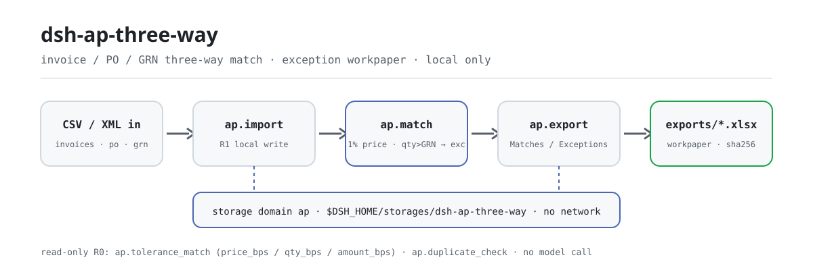
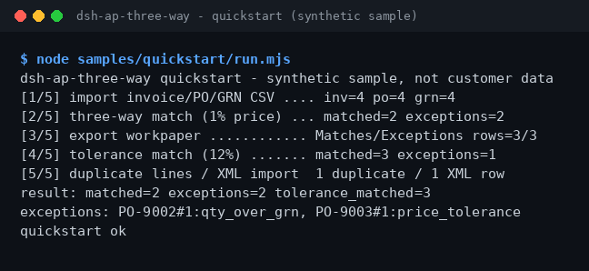

<div align="center">

<picture>
  <source media="(prefers-color-scheme: dark)" srcset="docs/assets/dsh-ap-three-way-flow-dark.svg">
  
</picture>

# dsh-ap-three-way

**把发票、采购单、收货单逐行对上——能过账的放行，例外连同原因写进底稿。**

面向 DeepSeek Harness 的纯本地 AP 三单匹配插件：CSV/XML 导入、默认 1% 价格容差、可按 bps 调整的容差策略与重复行检测，全程不联网、不调用模型。

[安装](#三步上手) · [配置](#配置) · [FAQ](#faq) · [简体中文](README.md) · [English](README.en.md) · [Español](README.es.md) · [Português](README.pt.md) · [हिन्दी](README.hi.md)

[](LICENSE)
[](#兼容性)
[](https://www.npmjs.com/package/dsh-ap-three-way)
[](https://github.com/PerryLink/dsh-ap-three-way/actions/workflows/ci.yml)
[](#兼容性)

[](https://github.com/PerryLink/dsh-ap-three-way/stargazers)
[](https://www.npmjs.com/package/dsh-ap-three-way)
[](https://dshfind.com/plugins/PerryLink/dsh-ap-three-way?ref=badge)
[](https://dsh.market/)
[](https://gitee.com/perrylink/dsh-ap-three-way)

```sh
dsh plugin --profile <profile> add dsh-ap-three-way
```

</div>

<sub>社区插件，与 DeepSeek 官方无关。唯一仓库：<https://github.com/PerryLink/dsh-ap-three-way>（Gitee 为镜像）。状态：alpha · 仅用公开/合成数据验证 · 非 GA——不含客户数据或客户证据，不作生产可用声明。</sub>

## 它是什么

应付会计的三单匹配：把发票行逐行对上采购单（PO）与收货单（GRN），单价默认按 1% 容差放行，数量超过收货、PO 缺失、收货缺失都计为例外；匹配结果与例外原因落进本地存储域，一条命令导出两表 xlsx 底稿（Matches / Exceptions）。全部计算在本机完成——不联网、不调用模型、不上传；输入由会话读取后作为参数传给工具，原文件不动。

- **适合**：几十到几百行的发票、采购单、收货单 CSV；需要按容差给出「可过账 / 例外」清单并留底稿的应付对账。
- **不适合**：需要自动过账、修改供应商主数据或替代审批的场景；本包只做本地匹配，不改任何单据。

## 三步上手

1. **安装**（三选一）：

   ```sh
   # npm 通道（推荐，已发布版本）
   dsh plugin --profile <profile> add dsh-ap-three-way
   # git 通道（最新 main；等价于 git+https://github.com/PerryLink/dsh-ap-three-way.git）
   dsh plugin --profile <profile> add github:PerryLink/dsh-ap-three-way
   # tarball 通道：本仓库 pnpm pack 后
   dsh plugin --profile <profile> add ./dsh-ap-three-way-<version>.tgz
   ```

2. **最小配置**（安装命令已自动应用 bundle patch；手写 profile 时照抄这一行即可）：

   ```yaml
   - insert:
       - id: dsh-ap-three-way
         name: dsh-ap-three-way
   ```

   本插件没有任何插件级配置键；容差策略在调用工具时以参数传入，见「配置」。

3. **验证已生效**：

   ```sh
   dsh --profile <profile> --dump-config | grep dsh-ap-three-way
   ```

   仓库自带合成样例，直接跑一次看全链路（应在结尾输出 `quickstart ok`）：

   ```sh
   node samples/quickstart/run.mjs
   ```

   在会话里也可以直接说：

   > 帮我用自带样例做一次发票、采购单、收货单三单匹配，把能过的和例外分别列出来。

**卸载**：`dsh plugin --profile <profile> remove dsh-ap-three-way`（或从 profile patch 删掉该行）。

<details>
<summary>从 DSH Desktop 市场安装</summary>

所有 PerryLink 插件均可在 DSH Desktop 内置市场中浏览：**市场 → 来源 → 添加来源 → 粘贴** `https://perrylink-dsh-catalog.perrylink.workers.dev/catalog-source.json` **→ 选中**。安装仍需通过市场的 npm 身份校验与你的确认。

</details>

## 核心能力

- **三单匹配** —— `ap.match` 把每张发票行对上 PO 与 GRN：单价默认 1% 容差，数量超过收货即例外；matched / exception 连同原因写入本地存储域。
- **可配置容差重算** —— `ap.tolerance_match` 以 bps（万分之一）为单位独立设置价格、数量、金额容差；只读重算，不覆盖已存匹配。
- **重复发票行检测** —— `ap.duplicate_check` 在匹配前按供应商（大小写与空格不敏感）、PO 行、数量与金额找出重复行；只读。
- **例外底稿导出** —— `ap.export` 把 Matches / Exceptions 两张工作表写成 `exports/ap-<时间戳>.xlsx`，返回路径与 sha256。
- **发票 XML 导入** —— `ap.import_invoice_xml` 解析本地通用发票 XML（根节点 `<Invoice>`，含 `Seller/Name` 与 `Items/Item`）。
- **纯本地** —— 源码中没有 HTTP / DNS / WebSocket 调用；不连接 ERP / 供应商系统，不上传数据。

### 工具面

工具名是稳定 API（0.1.0 起有兼容承诺，破坏性变更需 minor 版本）；写文件的工具标 **R1（本地写）**，只读工具标 **R0**。

| 工具 | 用途 | 风险 |
|---|---|---|
| `ap.import` | 导入发票、PO 和 GRN 行（CSV 文本作为参数传入）；重复导入同一发票按 `skipped` 跳过 | R1 本地写 |
| `ap.import_invoice_xml` | 从本地通用发票 XML 导入发票行，可带 PO 引用 | R1 本地写 |
| `ap.match` | 三单匹配：默认 1% 单价容差，数量超收货即例外；写入匹配与例外 | R1 本地写 |
| `ap.export` | 导出 Matches / Exceptions 两表 xlsx 底稿 | R1 本地写 |
| `ap.tolerance_match` | 按可配置容差（bps）重算三单匹配；只读，不覆盖已存匹配 | R0 只读 |
| `ap.duplicate_check` | 匹配前检测重复发票行 | R0 只读 |

### 输入与输出

输入：

- 发票 CSV：UTF-8，表头 `supplier,invoice_no,po_no,line_no,qty,unit_price,amount`（`invoice_no` 可省略）。
- 采购单 CSV：`po_no,line_no,qty,unit_price,amount`；收货单 CSV：`po_no,line_no,qty`。
- 发票 XML：根节点 `<Invoice>`，含 `Seller/Name` 与 `Items/Item`（`Quantity` / `UnitPrice` / `Amount`）。
- 金额最多两位小数；建议单个文件 ≤5 MB。自带样例在 `samples/quickstart/input/`（合成数据，远小于 500 KB）。

输出：

- 终端摘要：可过账几行、例外几行，默认价格容差 1%。
- 底稿：`$DSH_HOME/storages/dsh-ap-three-way/exports/ap-<时间戳>.xlsx`，工作表 `Matches` / `Exceptions`，附 sha256。
- 原文件不会被修改。

### 示例

快速开始样例（合成数据，随包发布）：

```sh
node samples/quickstart/run.mjs        # 人类可读输出，结尾应为 quickstart ok
node samples/quickstart/run.mjs --json # 规范化结果，即金标 expected/result.json 的来源
```



*合成样例 → 金标 `samples/quickstart/expected/result.json`；命令与输出哈希见 `screenshots.json`（2026-11-02 真实运行）。*

公开 fixture 验收：输入 [`fixtures/public/mit/invoice-github-sample.xml`](https://github.com/PerryLink/dsh-ap-three-way/blob/main/fixtures/public/mit/invoice-github-sample.xml)（公开 MIT 样本），重跑 `node scripts/acceptance.mjs`，明细见 `ACCEPTANCE.csv`：

| req_id | metric | threshold | actual | pass | source | counted |
|---|---|---|---|---|---|---|
| SKU-05-A01 | 发票行解析 | 20/20 | 20 | true | public/synthetic | false |
| PS1-QS01 | quickstart 样例与金标一致 | 1/1 | 1 | true | synthetic/quickstart | true |

*SKU 行是公开/合成 fixture 检查（`counted=false`）；PS1-QS01 是随包样例的本地复现（`counted=true`）。均非客户运行，没有虚构输出。*

## 配置

本插件没有 Schemastery `Config` 配置键——`cordis.patch.yml` 只 `insert` 一行（见「三步上手」），没有可覆盖的插件级配置项。容差策略在调用 `ap.tolerance_match` 时以参数传入：

| 参数 | 默认值 | 含义 |
|---|---|---|
| `price_bps` | `100` | 单价容差，单位万分之一（100 = 1%）；0–10000 的整数 |
| `qty_bps` | `0` | 数量容差（相对收货数量）；默认 0，数量超收货即例外 |
| `amount_bps` | `0` | 金额容差；默认 0，不启用金额维度 |
| `min_price_cents` | `1` | 单价容差下限（分），防止小额行被过严判定 |

越界参数（非整数、负数、大于 10000）在调用时响亮失败，报错形如 `容差参数 price_bps 超出范围（E_AP_POLICY）｜下一步：把 price_bps 设为 0–10000 的整数`。`ap.match` 固定使用默认 1% 单价容差与「数量不超收货」，只有 `ap.tolerance_match` 接受这四个参数。

## FAQ

<details>
<summary>数据到底存在哪？原文件会被改吗？</summary>

匹配状态（发票、PO、GRN、匹配结果）只写本地存储域 `$DSH_HOME/storages/dsh-ap-three-way`；导出的底稿写在其 `exports/` 子目录。输入 CSV / XML 由会话读取后作为参数传给工具——原文件不会被修改，也没有任何数据被上传。

</details>

<details>
<summary>装不上怎么办？</summary>

确认 DSH `>=0.2.1-rc.3 <0.4.0`、Node `>=24.9 <25`，并用全新的 `DSH_HOME` 重试；完整步骤见 [TROUBLESHOOTING.md](TROUBLESHOOTING.md)。

</details>

<details>
<summary>价格在 1% 以内，为什么还是例外？</summary>

默认容差只放宽「单价」，数量超过收货单（`qty_over_grn`）仍然算例外；PO 缺失（`po_missing`）、收货缺失（`grn_missing`）同理。需要放宽时用 `ap.tolerance_match` 显式传 `price_bps` / `qty_bps` / `amount_bps` 调容差，并保留策略参数备查。

</details>

<details>
<summary>能处理我的真实发票吗？</summary>

可以本地运行，但本包是 alpha、只用公开/合成数据验证，不构成审计或付款结论；使用真实数据前请脱敏，并保留复核人。

</details>

<details>
<summary>会联网或上传数据吗？</summary>

不会。工具、样例和导出都在本机完成；源码中没有 HTTP / DNS / WebSocket 调用。

</details>

## 安全边界

- **不联网、不调用模型。** 除非工具明确说明，否则没有模型或网络调用；输入和输出都留在本地。
- **原文件不被修改。** 写操作只落在 `$DSH_HOME/storages/dsh-ap-three-way`（匹配状态与 `exports/*.xlsx`）。
- **导出路径穿越防护。** 导出文件名经 safe-path 守卫；发票 id 取内容哈希；PO / GRN 做表头校验；重复导入同一发票幂等跳过。
- **错误格式统一、失败响亮。** 报错统一为 `<一句人话>（E_XXX）｜下一步：<动作>`；完整报错与堆栈只写日志，不打印内部路径。三类常见错误（金额读不懂 `E_AP_CSV_INVALID`、CSV 缺列 `E_AP_CSV_INVALID`、容差越界 `E_AP_POLICY`）的症状 / 原因 / 动作见 [TROUBLESHOOTING.md](TROUBLESHOOTING.md)。

## 权限与数据

- **读**：你指定的发票 / 采购单 / 收货单 CSV 与发票 XML（由会话读取后作为参数传入）；不读其他目录。
- **写**：`$DSH_HOME/storages/dsh-ap-three-way`（匹配状态与 `exports/*.xlsx`）；不改原文件。
- **联网**：否（源码中没有 HTTP / DNS / WebSocket 调用）。
- **外部系统**：无（不连接 ERP / 供应商系统，不上传数据）。
- **数据边界**：仅公开/合成样例验证；不含客户数据或客户证据。

## 已知限制

- **仅公开/合成数据验证。** 所有验收行都来自公开或合成 fixture（`ACCEPTANCE.csv` 中 SKU 行 `counted=false`，PS1-QS01 为样例本地复现 `counted=true`）；不含客户数据或客户证据。
- **alpha / partial / not counted / 非 GA。** 不作生产可用声明，不构成审计或付款结论。
- **只做匹配，不做入账。** 不自动过账、不修改供应商主数据、不替代审批；本包只做本地匹配，不改任何单据。
- **输入格式约束。** 金额最多两位小数；建议单个文件 ≤5 MB；CSV 表头必须逐字匹配（缺列报 `E_AP_CSV_INVALID`）。
- **每个工具的精确边界**见「核心能力」的工具表与 `ACCEPTANCE.csv`。

## 兼容性

| 维度 | 状态 |
|---|---|
| Harness | DeepSeek Harness `>=0.2.1-rc.3 <0.4.0`（`package.json` 的 `engines.dsh`） |
| Node | `>=24.9.0 <25`（`.nvmrc`：24） |
| 平台 | 任何 DSH 可运行处；仅本地文件 |
| 数据 | 不联网、不调用模型、不上传 |

## 生态与质量

- [Gitee 镜像](https://gitee.com/perrylink/dsh-ap-three-way)（同步镜像，以 GitHub 为准）
- [dshfind 插件页](https://dshfind.com/plugins/PerryLink/dsh-ap-three-way)（安装量与排名）
- [DSH Market](https://dsh.market/)（已上架）
- **1024 商店渠道**：先 `npm i -g dsh1024`，再 `dsh1024 plugin --profile <profile> add dsh-ap-three-way`（计入 [deepseek1024.com](https://deepseek1024.com) 安装排行）
- [领域索引](https://perrylink.github.io/dsh-plugins/) · [Checker 家族](https://perrylink.github.io/zh/checkers/) · [场景文章](https://perrylink.github.io/dsh-plugins/articles/finops-suite.html)

### 相关项目与核查器

兄弟包与家族索引：[dsh-einvoice](https://github.com/PerryLink/dsh-einvoice) · [dsh-bankrec](https://github.com/PerryLink/dsh-bankrec) · [dsh-travel-recon](https://github.com/PerryLink/dsh-travel-recon) · [dsh-finops-suite](https://github.com/PerryLink/dsh-finops-suite)

每个核查器都是独立包、各有自己的规则包与版本，按需安装：

| 包 | 为何相关 |
|---|---|
| [`dsh-invoice-ledger`](https://github.com/PerryLink/dsh-invoice-ledger) | 三单匹配之前或之后做发票侧的重复与算术检查 |
| [`dsh-excel-reconcile`](https://github.com/PerryLink/dsh-excel-reconcile) | PO/GRN 以平表到达时的两表对齐兜底 |

## 开发

```sh
pnpm install --frozen-lockfile                            # node >=24.9 <25
pnpm build && pnpm lint && pnpm typecheck && pnpm test    # tsc 构建 + lint + 26 个 node --test 用例
pnpm gate:sku05                                           # 验收门禁（ACCEPTANCE.csv）
node scripts/acceptance.mjs                               # 重跑公开/合成验收
node samples/quickstart/run.mjs                           # 合成样例，应输出 quickstart ok
```

当前版本 `0.1.1`（与 `package.json` 一致）。测试：`node --test test/*.test.mjs` 全绿（10 个测试文件、26 个用例；`pnpm test` 已内置构建步骤）。配图由 [`scripts/gen-readme-assets.py`](scripts/gen-readme-assets.py) 程序化生成（Python；SVG 流程图深浅双版、五语共用），可重复执行：`python scripts/gen-readme-assets.py`。

Topics：`deepseek-harness`, `dsh`, `dsh-plugin`, `ap`, `three-way-match`, `finance`, `perrylink`, `invoice`

## 家族与致谢

本项目是 [PerryLink](https://github.com/PerryLink) 维护的 DeepSeek Harness 插件家族成员（全部 Apache-2.0）。如果这个插件帮到了你，**给个 star**——它不解锁任何功能，但会让下一个人更容易找到它。

- [@PerryLink](https://github.com/PerryLink) —— 创建者与维护者：三单匹配引擎与容差策略、六个 `ap.*` 工具、quickstart 样例与验收套件、五语文档。

## License

[LICENSE](LICENSE)（Apache License 2.0）© 2026 dsh-ap-three-way contributors；另见 `NOTICE` 与 `THIRD-PARTY-NOTICES`。

<p align="center"><sub>Apache-2.0 · 社区插件，与 DeepSeek 无关。</sub></p>
