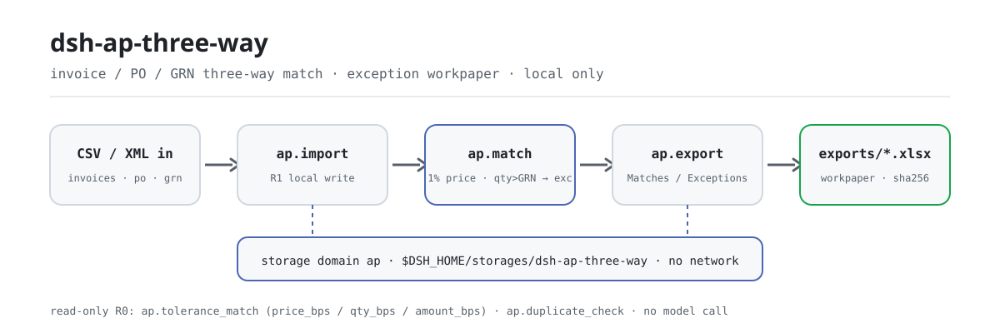
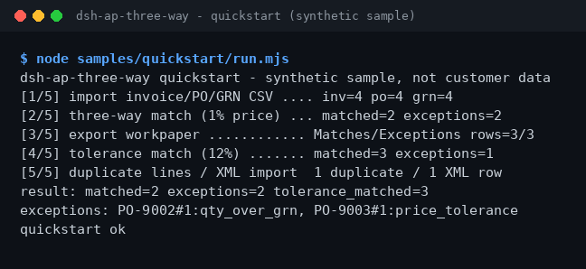

<div align="center">

<picture>
  <source media="(prefers-color-scheme: dark)" srcset="docs/assets/dsh-ap-three-way-flow-dark.svg">
  
</picture>

# dsh-ap-three-way

**Concilie faturas, pedidos de compra e recebimentos linha a linha — as linhas lançáveis passam e as exceções caem numa planilha de trabalho com seus motivos.**

Um plugin de conciliação tripla de AP puramente local para o DeepSeek Harness: importação CSV/XML, tolerância de preço padrão de 1%, política de tolerância ajustável em bps e detecção de linhas duplicadas — sem rede e sem chamada a modelo.

[Instalar](#instalação-em-três-passos) · [Configuração](#configuração) · [FAQ](#faq) · [简体中文](README.md) · [English](README.en.md) · [Español](README.es.md) · [Português](README.pt.md) · [हिन्दी](README.hi.md)

[](LICENSE)
[](#compatibilidade)
[](https://www.npmjs.com/package/dsh-ap-three-way)
[](https://github.com/PerryLink/dsh-ap-three-way/actions/workflows/ci.yml)
[](#compatibilidade)

[](https://github.com/PerryLink/dsh-ap-three-way/stargazers)
[](https://www.npmjs.com/package/dsh-ap-three-way)
[](https://dshfind.com/plugins/PerryLink/dsh-ap-three-way?ref=badge)
[](https://dsh.market/)
[](https://gitee.com/perrylink/dsh-ap-three-way)

```sh
dsh plugin --profile <profile> add dsh-ap-three-way
```

</div>

<sub>Plugin da comunidade, sem afiliação com a DeepSeek. Repositório canônico: <https://github.com/PerryLink/dsh-ap-three-way> (o Gitee é um espelho). Status: alpha · verificado apenas com dados públicos/sintéticos · não GA — sem dados ou evidência de clientes, sem promessa de produção.</sub>

## O que é

Conciliação tripla de contas a pagar: cada linha de fatura é confrontada com seu pedido de compra (OC) e seu recebimento (GRN); o preço unitário passa dentro de uma tolerância padrão de 1%, enquanto quantidade acima do recebido, OC ausente ou recebimento ausente contam como exceção. Os resultados e os motivos das exceções ficam num domínio de armazenamento local, e um comando exporta uma planilha xlsx de duas abas (Matches / Exceptions). Tudo roda na sua máquina — sem rede, sem chamada a modelo, sem upload; as entradas são lidas pela sessão e passadas às ferramentas como argumentos, e os arquivos originais não são tocados.

- **Indicado para**: CSVs de faturas/OC/recebimentos de dezenas a algumas centenas de linhas; reconciliações de AP que precisam de uma lista «lançável / exceção» sob uma política de tolerância, com planilha de trabalho.
- **Não indicado para**: lançamento automático, alterações no cadastro de fornecedores ou substituição de aprovações; este pacote só concilia localmente e não modifica nenhum documento.

## Instalação em três passos

1. **Instalar** (escolha um canal):

   ```sh
   # canal npm (recomendado; versões publicadas)
   dsh plugin --profile <profile> add dsh-ap-three-way
   # canal git (main mais recente; equivalente a git+https://github.com/PerryLink/dsh-ap-three-way.git)
   dsh plugin --profile <profile> add github:PerryLink/dsh-ap-three-way
   # canal tarball: pnpm pack neste repo, depois
   dsh plugin --profile <profile> add ./dsh-ap-three-way-<version>.tgz
   ```

2. **Configuração mínima** (o comando de instalação já aplica o bundle patch; perfis escritos à mão colam esta única linha):

   ```yaml
   - insert:
       - id: dsh-ap-three-way
         name: dsh-ap-three-way
   ```

   O plugin não tem chaves de configuração próprias; a política de tolerância é passada como argumentos da ferramenta — ver «Configuração».

3. **Verificar que monta**:

   ```sh
   dsh --profile <profile> --dump-config | grep dsh-ap-three-way
   ```

   O repo traz uma amostra sintética: rode a cadeia completa uma vez (deve terminar com `quickstart ok`):

   ```sh
   node samples/quickstart/run.mjs
   ```

   Dentro de uma sessão, basta pedir (prompt citado de `dsh.demo` no `package.json`):

   ```text
   帮我用自带样例做一次发票、采购单、收货单三单匹配，把能过的和例外分别列出来。
   ```

**Desinstalar**: `dsh plugin --profile <profile> remove dsh-ap-three-way` (ou remova a linha do patch do perfil).

<details>
<summary>Instalar pela loja do DSH Desktop</summary>

Todos os plugins da PerryLink estão na loja embutida do DSH Desktop: **Market → Sources → Add source → cole** `https://perrylink-dsh-catalog.perrylink.workers.dev/catalog-source.json` **→ selecione**. A instalação ainda exige a verificação de identidade npm da loja e a sua confirmação.

</details>

## Capacidades principais

- **Conciliação tripla** — `ap_match` confronta cada linha de fatura com sua OC e seu GRN: tolerância de preço unitário padrão de 1%, e quantidade acima do recebido é exceção; matched/exception e o motivo são gravados no domínio de armazenamento local.
- **Recálculo com tolerância configurável** — `ap_tolerance_match` define tolerâncias de preço, quantidade e valor de forma independente em pontos-base; somente leitura, nunca sobrescreve as conciliações gravadas.
- **Detecção de linhas de fatura duplicadas** — `ap_duplicate_check` marca duplicatas antes da conciliação por fornecedor (sem distinguir maiúsculas nem espaços), linha de OC, quantidade e valor; somente leitura.
- **Exportação da planilha de exceções** — `ap_export` grava as abas Matches / Exceptions em `exports/ap-<timestamp>.xlsx` e devolve o caminho com seu sha256.
- **Importação de XML de fatura** — `ap_import_invoice_xml` analisa um XML de fatura genérico local (raiz `<Invoice>`, com `Seller/Name` e `Items/Item`).
- **Puramente local** — sem chamadas HTTP / DNS / WebSocket no código; sem conexões com ERP nem sistemas de fornecedores, nada é enviado.

### Superfície de ferramentas

Os nomes das ferramentas são uma API estável (promessa de compatibilidade desde 0.1.0: mudanças disruptivas exigem bump minor). Ferramentas que escrevem são marcadas **R1 (escrita local)**, as de somente leitura **R0**.

Desde 0.2.0 os nomes usam sublinhado (ex.: `ap_import`): o provedor valida `tools[].name` com `^[a-zA-Z0-9_-]+$` e um ponto faz o array `tools` inteiro ser rejeitado. Os nomes com ponto não são mais registrados; migre conforme a tabela abaixo.

| Ferramenta | Finalidade | Risco |
|---|---|---|
| `ap_import` | Importar linhas de fatura, OC e GRN (texto CSV como argumentos); reimportar a mesma fatura é pulado via `skipped` | R1 escrita local |
| `ap_import_invoice_xml` | Importar linhas de fatura de um XML genérico local, com referência de OC opcional | R1 escrita local |
| `ap_match` | Conciliação tripla: tolerância de preço unitário padrão de 1%, quantidade acima do recebido é exceção; grava conciliações e exceções | R1 escrita local |
| `ap_export` | Exportar a planilha xlsx de duas abas Matches / Exceptions | R1 escrita local |
| `ap_tolerance_match` | Refazer a conciliação tripla com tolerância configurável (bps); somente leitura, não sobrescreve o gravado | R0 somente leitura |
| `ap_duplicate_check` | Detectar linhas de fatura duplicadas antes da conciliação | R0 somente leitura |

### Entrada e saída

Entrada:

- CSV de faturas: UTF-8, cabeçalho `supplier,invoice_no,po_no,line_no,qty,unit_price,amount` (`invoice_no` pode ser omitido).
- CSV de OC: `po_no,line_no,qty,unit_price,amount`; CSV de GRN: `po_no,line_no,qty`.
- XML de fatura: raiz `<Invoice>` com `Seller/Name` e `Items/Item` (`Quantity` / `UnitPrice` / `Amount`).
- Valores com no máximo duas casas decimais; cada arquivo ≤5 MB recomendado. A amostra incluída fica em `samples/quickstart/input/` (sintética, bem abaixo de 500 KB).

Saída:

- Resumo no terminal: quantas linhas lançáveis e quantas exceções, na tolerância de preço padrão de 1%.
- Planilha de trabalho: `$DSH_HOME/storages/dsh-ap-three-way/exports/ap-<timestamp>.xlsx` com as abas `Matches` / `Exceptions`, mais um sha256.
- Os arquivos originais nunca são modificados.

### Exemplos

Amostra de início rápido (sintética, incluída no pacote):

```sh
node samples/quickstart/run.mjs        # transcrição legível, deve terminar com quickstart ok
node samples/quickstart/run.mjs --json # resultado canônico — origem do gabarito expected/result.json
```



*Amostra sintética → arquivo de gabarito `samples/quickstart/expected/result.json`; o comando e os hashes de saída estão em `screenshots.json` (execução real em 2026-11-02).*

Aceitação com fixture pública: entrada [`fixtures/public/mit/invoice-github-sample.xml`](https://github.com/PerryLink/dsh-ap-three-way/blob/main/fixtures/public/mit/invoice-github-sample.xml) (amostra MIT pública); repita com `node scripts/acceptance.mjs`. Detalhes em `ACCEPTANCE.csv`, citado literalmente:

```text
req_id,metric,threshold,actual,pass,source,counted
SKU-05-A01,发票行解析,20/20,20,true,public/synthetic,false
PS1-QS01,quickstart 样例与金标一致,1/1,1,true,synthetic/quickstart,true
```

*A linha SKU é uma verificação de fixture pública/sintética (`counted=false`); PS1-QS01 é uma reprodução local da amostra incluída (`counted=true`). Nenhuma é execução de cliente e nenhuma saída é inventada.*

## Configuração

Este plugin não tem chaves `Config` de Schemastery — o `cordis.patch.yml` apenas `insert` uma linha (ver «Instalação em três passos»), portanto não há chave de plugin para sobrescrever. A política de tolerância é passada como argumentos ao `ap_tolerance_match`:

| Parâmetro | Padrão | Significado |
|---|---|---|
| `price_bps` | `100` | Tolerância de preço unitário em pontos-base (100 = 1%); inteiro 0–10000 |
| `qty_bps` | `0` | Tolerância de quantidade relativa ao recebido; padrão 0 — quantidade acima do recebido é exceção |
| `amount_bps` | `0` | Tolerância de valor; padrão 0, a dimensão de valor fica desativada |
| `min_price_cents` | `1` | Piso da tolerância de preço unitário (centavos), para que linhas de valor pequeno não sejam julgadas com rigor excessivo |

Argumentos fora da faixa (não inteiros, negativos, acima de 10000) falham em voz alta na chamada, no formato de erro `<o que aconteceu>（E_XXX）｜下一步：<ação>`, por exemplo:

```text
容差参数 price_bps 超出范围（E_AP_POLICY）｜下一步：把 price_bps 设为 0–10000 的整数
```

O `ap_match` usa sempre a tolerância de preço unitário padrão de 1% mais «quantidade não acima do recebido»; apenas o `ap_tolerance_match` aceita estes quatro parâmetros.

## FAQ

<details>
<summary>Onde os dados ficam? Meus arquivos originais são tocados?</summary>

O estado da conciliação (faturas, OC, GRN, resultados) só é gravado no domínio de armazenamento local `$DSH_HOME/storages/dsh-ap-three-way`; as planilhas exportadas vão para o subdiretório `exports/`. As entradas CSV / XML são lidas pela sessão e passadas às ferramentas como argumentos — os arquivos originais nunca são modificados e nada é enviado.

</details>

<details>
<summary>E se a instalação falhar?</summary>

Confirme DSH `>=0.2.1-rc.3 <0.4.0` e Node `>=24.9 <25`, e tente de novo com um `DSH_HOME` novo; os passos completos estão em [TROUBLESHOOTING.md](TROUBLESHOOTING.md).

</details>

<details>
<summary>O preço está dentro de 1% — por que a linha ainda é exceção?</summary>

A tolerância padrão só relaxa o «preço unitário»; quantidade acima do recebimento (`qty_over_grn`) continua exceção, assim como OC ausente (`po_missing`) e recebimento ausente (`grn_missing`). Para relaxar mais, chame `ap_tolerance_match` com `price_bps` / `qty_bps` / `amount_bps` explícitos e guarde os parâmetros da política.

</details>

<details>
<summary>Ele processa minhas faturas reais?</summary>

Roda localmente, mas o pacote é alpha e verificado apenas com dados públicos/sintéticos — não constitui conclusão de auditoria nem de pagamento. Anonimize dados reais antes de usar e mantenha um revisor humano.

</details>

<details>
<summary>Ele faz chamadas de rede ou envia dados?</summary>

Não. As ferramentas, a amostra e a exportação rodam na sua máquina; o código não contém chamadas HTTP / DNS / WebSocket.

</details>

## Limites de segurança

- **Sem rede, sem chamada a modelo.** Salvo indicação explícita de uma ferramenta, não há chamada de modelo nem de rede; entrada e saída permanecem locais.
- **Os arquivos originais nunca são modificados.** As escritas caem apenas em `$DSH_HOME/storages/dsh-ap-three-way` (estado da conciliação e `exports/*.xlsx`).
- **Guarda contra path traversal na exportação.** Os nomes de arquivo exportados passam por uma guarda safe-path; os ids de fatura são hashes de conteúdo; os cabeçalhos de OC/GRN são validados; reimportar a mesma fatura é pulado de forma idempotente.
- **Erros uniformes, falhas em voz alta.** Os erros seguem o formato `<o que aconteceu>（E_XXX）｜下一步：<ação>`; o erro completo e a pilha só vão para o log e nunca imprimem caminhos internos. Os três casos mais comuns — valor ilegível (`E_AP_CSV_INVALID`), coluna CSV ausente (`E_AP_CSV_INVALID`), tolerância fora da faixa (`E_AP_POLICY`) — aparecem com sintoma/causa/ação em [TROUBLESHOOTING.md](TROUBLESHOOTING.md).

## Permissões e dados

- **Lê**: os CSVs de fatura / OC / GRN e o XML de fatura que você indicar (lidos pela sessão e passados como argumentos); nenhum outro diretório.
- **Escreve**: `$DSH_HOME/storages/dsh-ap-three-way` (estado da conciliação e `exports/*.xlsx`); originais intactos.
- **Rede**: não (sem chamadas HTTP / DNS / WebSocket no código).
- **Sistemas externos**: nenhum (sem conexões com ERP nem sistemas de fornecedores, sem uploads).
- **Fronteira de dados**: verificado apenas com amostras públicas/sintéticas; sem dados ou evidência de clientes.

## Limitações conhecidas

- **Verificado apenas com dados públicos/sintéticos.** Cada linha de aceitação vem de uma fixture pública ou sintética (linhas SKU com `counted=false` em `ACCEPTANCE.csv`; PS1-QS01 é uma reprodução local da amostra com `counted=true`); sem dados ou evidência de clientes.
- **Alpha / parcial / não contabilizado / não GA.** Sem promessa de produção; não constitui conclusão de auditoria nem de pagamento.
- **Só concilia, não lança.** Não lança automaticamente, não altera o cadastro de fornecedores nem substitui aprovações; só concilia localmente e não modifica nenhum documento.
- **Restrições de formato de entrada.** Valores com no máximo duas casas decimais; cada arquivo ≤5 MB recomendado; os cabeçalhos CSV devem coincidir literalmente (uma coluna ausente gera `E_AP_CSV_INVALID`).
- **Os limites exatos por ferramenta** são a tabela de ferramentas acima mais o `ACCEPTANCE.csv`.

## Compatibilidade

| Superfície | Status |
|---|---|
| Harness | DeepSeek Harness `>=0.2.1-rc.3 <0.4.0` (`engines.dsh` no `package.json`) |
| Node | `>=24.9.0 <25` (`.nvmrc`: 24) |
| Plataformas | Onde o DSH rodar; apenas arquivos locais |
| Dados | Sem rede, sem chamada a modelo, sem upload |

## Ecossistema e qualidade

- [Espelho no Gitee](https://gitee.com/perrylink/dsh-ap-three-way) (espelho sincronizado; o GitHub é o canônico)
- [Página do plugin no dshfind](https://dshfind.com/plugins/PerryLink/dsh-ap-three-way) (instalações e ranking)
- [DSH Market](https://dsh.market/) (listado)
- **Canal da loja 1024**: `npm i -g dsh1024` uma vez, depois `dsh1024 plugin --profile <profile> add dsh-ap-three-way` (conta no ranking de instalações da [deepseek1024.com](https://deepseek1024.com))
- [Índice de domínio](https://perrylink.github.io/dsh-plugins/) · [Família de checkers](https://perrylink.github.io/zh/checkers/) · [Artigo de cenário](https://perrylink.github.io/dsh-plugins/articles/finops-suite.html)

### Trabalho relacionado e checkers

Pacotes irmãos e índices da família: [dsh-einvoice](https://github.com/PerryLink/dsh-einvoice) · [dsh-bankrec](https://github.com/PerryLink/dsh-bankrec) · [dsh-travel-recon](https://github.com/PerryLink/dsh-travel-recon) · [dsh-finops-suite](https://github.com/PerryLink/dsh-finops-suite)

Cada checker é um pacote independente com seu próprio pacote de regras e versão; instale apenas os que você precisa:

| Pacote | Por que é relevante |
|---|---|
| [`dsh-invoice-ledger`](https://github.com/PerryLink/dsh-invoice-ledger) | Verificações de duplicatas e aritmética do lado da fatura antes ou depois da conciliação tripla |
| [`dsh-excel-reconcile`](https://github.com/PerryLink/dsh-excel-reconcile) | Alinhamento de duas tabelas como fallback quando os dados de OC/GRN chegam como arquivos planos |

## Desenvolvimento

```sh
pnpm install --frozen-lockfile                            # node >=24.9 <25
pnpm build && pnpm lint && pnpm typecheck && pnpm test    # build tsc + lint + 27 casos node --test
pnpm gate:sku05                                           # portão de aceitação (ACCEPTANCE.csv)
node scripts/acceptance.mjs                               # repetir a aceitação pública/sintética
node samples/quickstart/run.mjs                           # amostra sintética, deve imprimir quickstart ok
```

Versão atual `0.2.0` (confere com `package.json`). Testes: `node --test test/*.test.mjs` tudo verde (11 arquivos de teste, 27 casos; `pnpm test` compila antes). As imagens do README são geradas programaticamente por [`scripts/gen-readme-assets.py`](scripts/gen-readme-assets.py) (Python; par SVG de fluxo claro/escuro compartilhado pelos cinco idiomas) e podem ser refeitas: `python scripts/gen-readme-assets.py`.

Topics: `deepseek-harness`, `dsh`, `dsh-plugin`, `ap`, `three-way-match`, `finance`, `perrylink`, `invoice`

## Família e agradecimentos

Este projeto faz parte da família de plugins do DeepSeek Harness da [PerryLink](https://github.com/PerryLink) (todos Apache-2.0). Se for útil, **uma estrela ajuda a próxima pessoa a encontrá-lo** — nada fica bloqueado atrás dela.

- [@PerryLink](https://github.com/PerryLink) — criador e mantenedor: o motor de conciliação tripla e a política de tolerância, as seis ferramentas `ap.*`, a amostra quickstart e a suíte de aceitação, e a documentação em cinco idiomas.

## Licença

[LICENSE](LICENSE) (Apache License 2.0) © 2026 dsh-ap-three-way contributors; veja também `NOTICE` e `THIRD-PARTY-NOTICES`.

<p align="center"><sub>Apache-2.0 · Plugin da comunidade, sem afiliação com a DeepSeek.</sub></p>
